# accumulate_values — FP32 weighted-value accumulation

## 1. Overview

This function computes one lane's weighted-value result for [llama3_fast_attention](llama3_fast_attention.md). It shall combine each selected BF16 value with the matching FP32 online-normalization factors, retain the weighted sum in FP32, and divide by the final denominator before rounding the output to BF16.

Values are reused across the eligible causal query rows and the grouped query heads. This function does not convert softmax factors or probabilities to BF16, manage residency, or store output directly to host memory; the root drains its packed output stream.

## 2. Architecture and Dataflow



Figure 2-1. Functional/task view of accumulate_values. The frame names the callable boundary; internal responsibilities do not mandate a physical RTL partition.
[Diagram source](figures/accumulate_values-architecture.html)
This function has no direct sub-functions. The local endpoint represents this function's own computation or retained state, not another module.

| Datapath | Direction (producer / consumer) | Datatype | Description |
|---|---|---|---|
| `public.values` | `external -> self.values` | `brisk::value_stream&` | Public input interface: Selected BF16 value chunks in the same record order as QK keys; Reuse each selected value across its eligible rows and representative query heads. |
| `public.scales` | `external -> self.scales` | `brisk::scale_stream&` | Public input interface: Matched previous/current FP32 factors in score order; Preserve row/head/history association; no BF16 quantization. |
| `public.denominators` | `external -> self.denominators` | `brisk::denominator_stream&` | Public input interface: Final sums per query/local-KV-head group; Wait for the correct final sum before division. |
| `public.output` | `self.output -> external` | `brisk::output_stream&` | Public output interface: BF16 output in batch/query-row/local-query-head/dimension-pack order; Accept output after every visible contribution; parent commits external stores. |
| `public.request` | `external -> self.request` | `const brisk::TileRequest&` | Public input interface: Fixed lane, batch count, local rows, absolute context start, backing stride and identity; Parent preserves these values until local completion. |
| `values` | `self.values -> self` | `brisk::VChunk` | Selected values reused across eligible rows. |
| `scales` | `self.scales -> self` | `brisk::Scale` | Matched FP32 factors for each eligible query/history pair. |
| `denominators` | `self.denominators -> self` | `brisk::Denominator` | Final normalizing sums per query/local-head group. |
| `output` | `self -> self.output` | `qo_pack_t` | Packed BF16 lane output; parent owns external stores. |
| `tile_control` | `self.request -> self` | `brisk::TileRequest` | Stable control, not a queued payload token. |

The public rows name boundary crossings. Internal rows identify the separately
drawn handoffs inside the named function frame. Blocking channels preserve
payload order and association while a consumer stalls; scalar control remains
stable rather than becoming an invented queued transfer.



Figure 2-2. Primary logical interaction of accumulate_values. The illustrated ordering preserves required causal dependencies; independent lanes and downstream work may overlap when their associations and state obligations remain intact. Arrow spacing specifies no hardware timing.
[Diagram source](figures/accumulate_values-dataflow.html)
Public rows show the declared interface type; internal rows show the transferred data type.

## 3. Supported Data Types

| Symbol | Representation | Range / shape | Precision and overflow | Source |
|---|---|---|---|---|
| `bf16_t` | std::uint16_t carrying BF16 encoding | One BF16 element: sign, eight exponent bits and seven fraction bits. | Bit-preserving K/V transport; input expansion appends sixteen zero bits to form FP32. | [brisk_types.hpp](brisk_types.hpp), line 7 |
| `qo_pack_t` | `ap_uint<256>` | Sixteen BF16 elements; element i occupies bits `16*i` through `16*i+15`. | Packed raw tensor data; no arithmetic in the transport word. | [brisk_types.hpp](brisk_types.hpp), line 8 |
| `brisk::VChunk` | Aggregate bf16_t values[8] | Eight consecutive value dimensions for the same selected record. | Raw BF16 input to FP32 SV arithmetic. | [brisk_types.hpp](brisk_types.hpp), line 31 |
| `brisk::Scale` | Aggregate previous[4], current[4] FP32 and max_grew[4] bool | Per-query online-softmax factors associated with one score packet. | Standard exponential and FP32 recurrence; factors remain associated under backpressure. | [brisk_types.hpp](brisk_types.hpp), line 39 |
| `brisk::Denominator` | Aggregate float values[4] | Final normalizing sums for four query heads. | FP32 sum; final division precedes BF16 round-to-nearest ties-to-even. | [brisk_types.hpp](brisk_types.hpp), line 45 |
| `brisk::TileRequest` | struct { lane: int; batches: int; sequences: int; context_start: int; cache_stride: int; cache_identity: int; } | Stable local-tile control with one lane identity, tile row count and absolute context position. | Integer configuration only; inherited host validity and tile bounds apply. | [brisk_types.hpp](brisk_types.hpp), line 14 |
| `brisk::value_stream` | `hls::stream<VChunk>` | Ordered blocking task stream with the declared payload type. | Preserve payload values and association; no numerical quantization by transport. | [brisk_stream_types.hpp](brisk_stream_types.hpp), line 9 |
| `brisk::scale_stream` | `hls::stream<Scale>` | Ordered blocking task stream with the declared payload type. | Preserve payload values and association; no numerical quantization by transport. | [brisk_stream_types.hpp](brisk_stream_types.hpp), line 11 |
| `brisk::denominator_stream` | `hls::stream<Denominator>` | Ordered blocking task stream with the declared payload type. | Preserve payload values and association; no numerical quantization by transport. | [brisk_stream_types.hpp](brisk_stream_types.hpp), line 12 |
| `brisk::output_stream` | `hls::stream<qo_pack_t>` | Ordered blocking task stream with the declared payload type. | Preserve payload values and association; no numerical quantization by transport. | [brisk_stream_types.hpp](brisk_stream_types.hpp), line 13 |

## 4. Function Template

```cpp
#include "brisk_stream_types.hpp"

namespace brisk {
void accumulate_values(value_stream& values, scale_stream& scales,
                       denominator_stream& denominators,
                       output_stream& output, const TileRequest& request);
}
```

The declaration uses the shared public payload definitions. The parent owns
the validity and lifetime of the supplied memory and stream objects.

| Name | Direction | Type / shape | Meaning / units | Ownership / completion |
|---|---|---|---|---|
| `values` | input | `brisk::value_stream&` | Selected BF16 value chunks in the same record order as QK keys. | Reuse each selected value across its eligible rows and representative query heads. |
| `scales` | input | `brisk::scale_stream&` | Matched previous/current FP32 factors in score order. | Preserve row/head/history association; no BF16 quantization. |
| `denominators` | input | `brisk::denominator_stream&` | Final sums per query/local-KV-head group. | Wait for the correct final sum before division. |
| `output` | output | `brisk::output_stream&` | BF16 output in batch/query-row/local-query-head/dimension-pack order. | Accept output after every visible contribution; parent commits external stores. |
| `request` | input | `const brisk::TileRequest&` | Fixed lane, batch count, local rows, absolute context start, backing stride and identity. | Parent preserves these values until local completion. |
| `return` | return | `void` | Task completion, not a returned data value. | Return after all declared tokens and required state/memory effects complete. |

## 5. Template Parameters

No template parameters — the function refines its parent's fixed configuration and receives stable local-tile control.

## 6. Constraints

| Condition | Required behavior / rejection | Source |
|---|---|---|
| Parent-approved TileRequest: lane in 0..3; batches in 1..2; sequences in 1..16; `context_start+sequences<=cache_stride<=8192`. | The root validates the host call and supplies only legal local controls. This internal task adds no status/error ABI; missing service causes backpressure. | Implementation contract: host ABI, packing and caller lifecycle. |

For the following counts, `B` is the active batch count, `S` is the local
tile's new-row count, and `P` is its earlier-history count. Each count and
capacity applies to one lane stream, including when the interface is an array
of lane streams. `S` is not the full host `seqlen` when the root tiles a
larger invocation.

| Channel | Chosen capacity (tokens) | Produced and consumed per lane / tile | Buffering purpose |
| --- | --- | --- | --- |
| `values` | 128 | `B * (P + S) * 2 * 16` | Decouple selected values from the QK/normalization path's startup and consumption skew. |
| `scales` | 64 | `B * 2 * (S * P + S * (S + 1) / 2)` | Decouple factor generation from the corresponding value-consumer service. |
| `denominators` | 32 | `B * S * 2` | Retain completed-query sums while downstream normalization/output service stalls. |
| `output` | 64 | `B * S * 8 * 8` | Decouple packed lane output from the parent's external-memory stores. |

Packet counts follow the fixed head geometry and triangular causal visibility.
The capacities are exact initial integration settings, not paper constants,
minimum-depth proofs or achieved-throughput guarantees. Their adequacy depends
on the selected pipeline, memory service and startup skew; the actual
implementation shall validate finite backpressure and complete draining before
claiming a scheduling bound. Functional agreement alone does not establish
per-chunk FIFO adequacy.

## 7. Functional Description

### 7.1 Algorithm and Numeric Semantics

#### 7.1.1 Online weighted-value update

Expand selected BF16 values to FP32. For each eligible query/representative/dimension, update `u_new=u_old*previous+V*current` with the matched normalizer factors, using FP32 arithmetic. The first record uses `previous=0,current=1`. Each factor refers to the exact same lane, batch, query row, K/V head and history position as the value. Do not insert BF16 score or normalized-probability conversion.

#### 7.1.2 Final division and BF16 packing

After the final visible value and correct final denominator l, compute u/l in FP32. Round the result to BF16 using round-to-nearest, ties-to-even; pack sixteen dimensions per output word with the lowest indexed dimension in the least-significant sixteen bits. Emit all local query heads in parent order. The finite-input inference profile and independent comparison policy are inherited implementation contracts, not a universal paper accuracy or bit-identity guarantee.

#### 7.1.3 Local work unit and supply

Rows, local heads, positions and batches are folded through the lane. Physical
resource folding may differ if FP32 arithmetic, packet association and all
parent obligations remain intact; no paper-required multiplier count is implied.

| Logical work or hypothetical supply quantity | Target or bound |
| --- | --- |
| SIMD work granularity | Eight dimensions for four query representatives sharing one K/V head. |
| Chunks per head | 16. |
| Hypothetical chunk/query-row action interval | Target II = 1; not an achieved result. |
| Component work at that target | 32 FP32 updates with corresponding accumulator read/write service. |
| Value reuse | One eight-BF16 chunk reused across its `R` eligible rows. |
| Scale reuse | One factor packet reused across the row/head's dimension chunks. |
| Output packing | Sixteen final BF16 elements per output word. |

Final per-query sums enable FP32 division. State-port conflicts, recurrence
latency, aligned factor/value arrivals and finite output backpressure require
actual schedule and draining checks, not an assumed achieved II.

#### 7.1.4 Local numerical checks

For finite deterministic local check vectors, compare decoded BF16 output against an independently evaluated weighted-value recurrence, requiring finite values and `abs(actual-reference)<=max(2e-5,abs(reference)/128)`. Exact analytic cases additionally require their independently calculated BF16 encodings, including ties-to-even. These are conditions for the declared finite vector set, not universal paper accuracy bounds; FP32 accumulation/division and no BF16 probability conversion remain binding.

### 7.2 State and Completion

Weighted sums are invocation-local, independently indexed by batch, query row, local K/V head, representative and dimension. Initialize before first use; retain partial sums and pending record/factor association while stalled.

A final denominator does not permit completion while value work or output words remain pending. Return after every expected BF16 output word is accepted; the parent then completes its external-memory stores.

| State property | Contract |
|---|---|
| Retained state | no |
| Owner | This task's invocation-local arithmetic/traversal state |
| Lifetime | One local tile; no arithmetic state persists across calls. |
| Initialization | Initialize each query/head/dimension weighted sum to zero before its first contribution. |
| Completion | Finish FP32 accumulation and final division, round/pack BF16 and accept all output words. |



Figure 7-1. Conceptual invocation lifecycle. Local arithmetic state is discarded after completion; this view does not prescribe persistent controller state or a physical finite-state machine.
[Diagram source](figures/accumulate_values-state.html)

### 7.3 MMIO and Register Map

No MMIO — this internal function has a memory/stream interface and inherits invocation control; no numeric register map is defined.

### 7.4 Parent and Child Obligations

The parent provides valid controls, exact ordered inputs and eventual downstream/backing service, and waits for local completion. This leaf has no direct sub-functions; local implementation helpers remain part of this function's responsibility.

## 8. Usage and Examples

Informative example. A fresh causal tile with zero queries and keys and unit
values has an independently calculated, exactly representable result. The
leaf-specific construction below isolates the function's assigned responsibility.

```cpp
#include "brisk_stream_types.hpp"
#include <cassert>

int main() {
    const brisk::TileRequest request{0, 1, 1, 0, 64, 0};
    brisk::value_stream values;
    brisk::scale_stream scales;
    brisk::denominator_stream denominators;
    brisk::output_stream output;
    brisk::VChunk one_value{};
    brisk::Scale first{};
    brisk::Denominator final_sum{};
    for (auto& element : one_value.values)
        element = 0x3f80;
    for (int rep = 0; rep < 4; ++rep) {
        first.previous[rep] = 0.0f;
        first.current[rep] = 1.0f;
        first.max_grew[rep] = true;
        final_sum.values[rep] = 1.0f;
    }
    for (int head = 0; head < 2; ++head) {
        for (int chunk = 0; chunk < 16; ++chunk)
            values.write(one_value);
        scales.write(first);
        denominators.write(final_sum);
    }

    brisk::accumulate_values(values, scales, denominators, output, request);
    for (int word = 0; word < 64; ++word) {
        const auto packed = output.read();
        for (int i = 0; i < 16; ++i)
            assert(packed.range(16 * i + 15, 16 * i) == 0x3f80);
    }
    assert(output.empty());
}
```

| Observable | Expected result |
| --- | --- |
| Output elements | Every element is BF16 one, encoding `0x3f80`. |
| Normalization | A single visible value has unit weight and unit denominator. |

These are untimed C++ usage illustrations, not a standalone executed program.
Execution status: not run as a standalone example. They require the public HLS
headers and an implementation of the declared function. Preloading streams is
for software clarity; bounded hardware streams require concurrently serviced
producers and consumers.

## References

Kuan-Hsi Chen, Yan-Jhih Wang, Jui-Chi Yu, and Hsi-Pin Ma. “BRISK: Bypassing Repeated I/O via Single-Owner K/V Residency for Llama 3 Attention on FPGA.”

Paper §II (pp. 1–2) defines the architecture, grouped-query mapping, K/V ownership and numerical boundary.
Function boundaries, host ABI and packing, detailed caller lifecycle, finite-input
domain, numerical check conditions, logical work targets and chosen FIFO depths
are implementation contracts where the paper does not specify them. They are
not additional performance or physical-resource claims attributed to the paper.
