# llama3_fast_attention — BRISK dense causal attention

## 1. Overview

The BRISK kernel computes one layer of grouped-query attention while retaining a single authoritative K/V record across invocations. Its boundary begins with post-RoPE BF16 queries, keys and values and ends with BF16 attention output, before output projection. The callable and packed buffers preserve the established host interface.

Incoming records are installed and forwarded once. Exact resident matches supply history from on-chip UltraRAM; other visible history is read directly from HBM without allocating a resident slot. The attention computation remains dense when the visible sequence exceeds residency capacity. Rotary embedding, output projection, host transfers and scheduling of separate accelerator invocations are outside this function.

## 2. Architecture and Dataflow



Figure 2-1. Functional/task view of llama3_fast_attention. The frame names the callable boundary; internal responsibilities do not mandate a physical RTL partition.
[Diagram source](figures/llama3_fast_attention-architecture.html)
The root validates host controls, distributes active K/V and queries, coordinates the direct tasks and drains lane outputs to external memory.

| Sub-function | Responsibility |
|---|---|
| [serve_kv](serve_kv.md) | Select and stream each needed K/V record; install incoming records and write victims before reuse; history misses do not allocate. |
| [score_queries](score_queries.md) | Read associated query streams and selected key chunks; emit FP32 scores in the declared lane/query/history order. |
| [normalize_scores](normalize_scores.md) | Compute standard-exponential online rescaling and final denominator for all four lanes. |
| [accumulate_values](accumulate_values.md) | Combine selected value chunks with matched scale packets and final denominator, then emit rounded BF16 output words. |

| Datapath | Direction (producer / consumer) | Datatype | Description |
|---|---|---|---|
| `public.q0` | `external -> self.q0` | `const qo_pack_t *` | Public input interface: Packed query buffer for lane 0; BF16 query heads belonging to that lane; Caller-owned, stable until return; root reads and distributes every active query once. |
| `public.q1` | `external -> self.q1` | `const qo_pack_t *` | Public input interface: Packed query buffer for lane 1; BF16 query heads belonging to that lane; Caller-owned, stable until return; root reads and distributes every active query once. |
| `public.q2` | `external -> self.q2` | `const qo_pack_t *` | Public input interface: Packed query buffer for lane 2; BF16 query heads belonging to that lane; Caller-owned, stable until return; root reads and distributes every active query once. |
| `public.q3` | `external -> self.q3` | `const qo_pack_t *` | Public input interface: Packed query buffer for lane 3; BF16 query heads belonging to that lane; Caller-owned, stable until return; root reads and distributes every active query once. |
| `public.active_kv` | `external -> self.active_kv` | `const kv_pair_pack_t *` | Public input interface: Paired BF16 K and V for incoming tokens across all K/V heads; Caller-owned and stable until return; root distributes incoming records without creating authoritative backing copies. |
| `public.cache_kv0` | `external <-> self.cache_kv0` | `cache_line_t *` | Public inout interface: Backing HBM for the two K/V heads belonging to lane 0; Caller allocates and retains the same backing region throughout a live identity; only the corresponding K/V service reads history and writes displaced records. |
| `public.cache_kv1` | `external <-> self.cache_kv1` | `cache_line_t *` | Public inout interface: Backing HBM for the two K/V heads belonging to lane 1; Caller allocates and retains the same backing region throughout a live identity; only the corresponding K/V service reads history and writes displaced records. |
| `public.cache_kv2` | `external <-> self.cache_kv2` | `cache_line_t *` | Public inout interface: Backing HBM for the two K/V heads belonging to lane 2; Caller allocates and retains the same backing region throughout a live identity; only the corresponding K/V service reads history and writes displaced records. |
| `public.cache_kv3` | `external <-> self.cache_kv3` | `cache_line_t *` | Public inout interface: Backing HBM for the two K/V heads belonging to lane 3; Caller allocates and retains the same backing region throughout a live identity; only the corresponding K/V service reads history and writes displaced records. |
| `public.out0` | `self.out0 -> external` | `qo_pack_t *` | Public output interface: Packed BF16 attention output for lane 0; Caller supplies storage disjoint from all inputs/backing and other outputs; visible after successful return. |
| `public.out1` | `self.out1 -> external` | `qo_pack_t *` | Public output interface: Packed BF16 attention output for lane 1; Caller supplies storage disjoint from all inputs/backing and other outputs; visible after successful return. |
| `public.out2` | `self.out2 -> external` | `qo_pack_t *` | Public output interface: Packed BF16 attention output for lane 2; Caller supplies storage disjoint from all inputs/backing and other outputs; visible after successful return. |
| `public.out3` | `self.out3 -> external` | `qo_pack_t *` | Public output interface: Packed BF16 attention output for lane 3; Caller supplies storage disjoint from all inputs/backing and other outputs; visible after successful return. |
| `public.batch_size` | `external -> self.batch_size` | `int` | Public input interface: Active batch count; one or two; Passed by value and held for the complete invocation. |
| `public.seqlen` | `external -> self.seqlen` | `int` | Public input interface: New tokens per batch in this call; Passed by value and held for the complete invocation. |
| `public.start_pos` | `external -> self.start_pos` | `int` | Public input interface: Earlier-token count and absolute first incoming token position; Passed by value and held for the complete invocation. |
| `public.cache_stride` | `external -> self.cache_stride` | `int` | Public input interface: Backing-memory positions allocated per batch; Passed by value and held for the complete invocation. |
| `public.cache_valid_len` | `external -> self.cache_valid_len` | `int` | Public input interface: Valid earlier-token count; equals start_pos; Passed by value and held for the complete invocation. |
| `public.mask_mode` | `external -> self.mask_mode` | `int` | Public input interface: Causal masking selector; causal for prefill; Passed by value and held for the complete invocation. |
| `public.flags` | `external -> self.flags` | `int` | Public input interface: Paper-conforming execution requires zero flags; Passed by value and held for the complete invocation. |
| `public.cache_identity` | `external -> self.cache_identity` | `int` | Public input interface: Signed 32-bit identity interpreted as uint32 bits: low five bits select the layer; high twenty-seven bits encode the sequence epoch. Negative encodings are legal; Keep the encoding fixed while live. Reuse requires explicit retirement and tag invalidation at a fresh `start_pos=0`; never resume a retired sequence. |
| `public.status_out` | `self.status_out -> external` | `int *` | Public output interface: One status integer: success or detected argument error; Caller provides writable status storage; validation failure writes status before returning without invoking children or altering output/backing/resident state. |
| `keys` | `kv_lanes.keys -> score_lanes.keys` | `brisk::KChunk[4]` | Per-lane selected key chunks in batch, position, local K/V head, dimension-chunk order. The score task reuses each key for all causally eligible query rows. |
| `values` | `kv_lanes.values -> value_lanes.values` | `brisk::VChunk[4]` | Per-lane selected value chunks aligned with the key record; the value task reuses them across the eligible rows and associated query heads. |
| `scores` | `score_lanes.scores -> normalizer.scores` | `brisk::Score[4]` | One four-query score packet per causally visible (query row, K/V head, history position) in each lane. |
| `scales` | `normalizer.scales -> value_lanes.scales` | `brisk::Scale[4]` | One previous/current rescaling packet for each score packet, retaining identical lane/query/position association. |
| `denominators` | `normalizer.denominators -> value_lanes.denominators` | `brisk::Denominator[4]` | One final four-query normalizing sum per (batch, query row, local K/V head) in each lane. |
| `output_words` | `value_lanes.output -> self` | `qo_pack_t[4]` | Per-lane BF16 output words, drained by the root into the corresponding public output array. |
| `query_rep0` | `self -> score_lanes.q0` | `brisk::QPair[4]` | One query-pair stream per GQA representative across all lane instances. Within a lane, tokens follow batch, local K/V head, increasing dimension-pair and query-row order, matching the declared stream schedule; no key or score rounding occurs. |
| `query_rep1` | `self -> score_lanes.q1` | `brisk::QPair[4]` | One query-pair stream per GQA representative across all lane instances. Within a lane, tokens follow batch, local K/V head, increasing dimension-pair and query-row order, matching the declared stream schedule; no key or score rounding occurs. |
| `query_rep2` | `self -> score_lanes.q2` | `brisk::QPair[4]` | One query-pair stream per GQA representative across all lane instances. Within a lane, tokens follow batch, local K/V head, increasing dimension-pair and query-row order, matching the declared stream schedule; no key or score rounding occurs. |
| `query_rep3` | `self -> score_lanes.q3` | `brisk::QPair[4]` | One query-pair stream per GQA representative across all lane instances. Within a lane, tokens follow batch, local K/V head, increasing dimension-pair and query-row order, matching the declared stream schedule; no key or score rounding occurs. |
| `incoming_records` | `self -> kv_lanes.incoming` | `cache_line_t[4]` | The root distributes each incoming lane record in batch, new-token, local-K/V-head and line order. Its paired K/V values are installed and forwarded by the same K/V service. |
| `query_0` | `self.q0 -> self` | `qo_pack_t` | Root reads this lane's packed Q memory and locally distributes four query-representative streams, preserving query-head and dimension identity. |
| `backing_0` | `self.cache_kv0 -> kv_lanes.backing` | `cache_line_t *` | Borrowed read/write backing-memory handle for lane 0; passing the handle is not a payload read or a resident fill. |
| `output_0` | `self -> self.out0` | `qo_pack_t` | Root commits accepted output words to lane 0 output storage. |
| `query_1` | `self.q1 -> self` | `qo_pack_t` | Root reads this lane's packed Q memory and locally distributes four query-representative streams, preserving query-head and dimension identity. |
| `backing_1` | `self.cache_kv1 -> kv_lanes.backing` | `cache_line_t *` | Borrowed read/write backing-memory handle for lane 1; passing the handle is not a payload read or a resident fill. |
| `output_1` | `self -> self.out1` | `qo_pack_t` | Root commits accepted output words to lane 1 output storage. |
| `query_2` | `self.q2 -> self` | `qo_pack_t` | Root reads this lane's packed Q memory and locally distributes four query-representative streams, preserving query-head and dimension identity. |
| `backing_2` | `self.cache_kv2 -> kv_lanes.backing` | `cache_line_t *` | Borrowed read/write backing-memory handle for lane 2; passing the handle is not a payload read or a resident fill. |
| `output_2` | `self -> self.out2` | `qo_pack_t` | Root commits accepted output words to lane 2 output storage. |
| `query_3` | `self.q3 -> self` | `qo_pack_t` | Root reads this lane's packed Q memory and locally distributes four query-representative streams, preserving query-head and dimension identity. |
| `backing_3` | `self.cache_kv3 -> kv_lanes.backing` | `cache_line_t *` | Borrowed read/write backing-memory handle for lane 3; passing the handle is not a payload read or a resident fill. |
| `output_3` | `self -> self.out3` | `qo_pack_t` | Root commits accepted output words to lane 3 output storage. |
| `active_records` | `self.active_kv -> self` | `kv_pair_pack_t` | Root reads active paired K/V words, merges adjacent words and distributes lane-specific incoming-record streams without writing backing HBM. |
| `control_batch_size` | `self.batch_size -> self` | `int` | Root validates the by-value control and derives a fixed TileRequest before dispatching tasks. |
| `control_seqlen` | `self.seqlen -> self` | `int` | Root validates the by-value control and derives a fixed TileRequest before dispatching tasks. |
| `control_start_pos` | `self.start_pos -> self` | `int` | Root validates the by-value control and derives a fixed TileRequest before dispatching tasks. |
| `control_cache_stride` | `self.cache_stride -> self` | `int` | Root validates the by-value control and derives a fixed TileRequest before dispatching tasks. |
| `control_cache_valid_len` | `self.cache_valid_len -> self` | `int` | Root validates the by-value control and derives a fixed TileRequest before dispatching tasks. |
| `control_mask_mode` | `self.mask_mode -> self` | `int` | Root validates the by-value control and derives a fixed TileRequest before dispatching tasks. |
| `control_flags` | `self.flags -> self` | `int` | Root validates the by-value control and derives a fixed TileRequest before dispatching tasks. |
| `control_cache_identity` | `self.cache_identity -> self` | `int` | Root validates the by-value control and derives a fixed TileRequest before dispatching tasks. |
| `status` | `self -> self.status_out` | `int` | Root reports validation failure or successful completion after all required memory effects. |
| `request_kv_lanes` | `self -> kv_lanes.request` | `brisk::TileRequest` | Root derives and holds the accepted tile's lane, batch, row, absolute-position, stride and epoch controls until this task completes. |
| `request_score_lanes` | `self -> score_lanes.request` | `brisk::TileRequest` | Root derives and holds the accepted tile's lane, batch, row, absolute-position, stride and epoch controls until this task completes. |
| `request_normalizer` | `self -> normalizer.request` | `brisk::TileRequest` | Root derives and holds the accepted tile's lane, batch, row, absolute-position, stride and epoch controls until this task completes. |
| `request_value_lanes` | `self -> value_lanes.request` | `brisk::TileRequest` | Root derives and holds the accepted tile's lane, batch, row, absolute-position, stride and epoch controls until this task completes. |
| `backing_commit_0` | `kv_lanes.backing -> self.cache_kv0` | `cache_line_t *` | The lane K/V service commits displaced payload updates through its borrowed backing handle; this is an in-place memory effect, not a FIFO or a new authoritative resident copy. |
| `backing_commit_1` | `kv_lanes.backing -> self.cache_kv1` | `cache_line_t *` | The lane K/V service commits displaced payload updates through its borrowed backing handle; this is an in-place memory effect, not a FIFO or a new authoritative resident copy. |
| `backing_commit_2` | `kv_lanes.backing -> self.cache_kv2` | `cache_line_t *` | The lane K/V service commits displaced payload updates through its borrowed backing handle; this is an in-place memory effect, not a FIFO or a new authoritative resident copy. |
| `backing_commit_3` | `kv_lanes.backing -> self.cache_kv3` | `cache_line_t *` | The lane K/V service commits displaced payload updates through its borrowed backing handle; this is an in-place memory effect, not a FIFO or a new authoritative resident copy. |

The public rows name boundary crossings. Internal rows identify the separately
drawn handoffs inside the named function frame. Blocking channels preserve
payload order and association while a consumer stalls; scalar control remains
stable rather than becoming an invented queued transfer.



Figure 2-2. Primary logical interaction of llama3_fast_attention. The illustrated ordering preserves required causal dependencies; independent lanes and downstream work may overlap when their associations and state obligations remain intact. Arrow spacing specifies no hardware timing.
[Diagram source](figures/llama3_fast_attention-dataflow.html)
Public rows show the declared interface type; internal rows show the transferred data type.

## 3. Supported Data Types

| Symbol | Representation | Range / shape | Precision and overflow | Source |
|---|---|---|---|---|
| `bf16_t` | std::uint16_t carrying BF16 encoding | One BF16 element: sign, eight exponent bits and seven fraction bits. | Bit-preserving K/V transport; input expansion appends sixteen zero bits to form FP32. | [brisk_types.hpp](brisk_types.hpp), line 7 |
| `qo_pack_t` | `ap_uint<256>` | Sixteen BF16 elements; element i occupies bits `16*i` through `16*i+15`. | Packed raw tensor data; no arithmetic in the transport word. | [brisk_types.hpp](brisk_types.hpp), line 8 |
| `kv_pair_pack_t` | `ap_uint<256>` | Eight BF16 K elements in bits 0..127 and their eight BF16 V elements in bits 128..255. | Raw paired payload; source changes preserve all bits. | [brisk_types.hpp](brisk_types.hpp), line 9 |
| `cache_line_t` | `ap_uint<512>` | Two consecutive paired K/V packs; lower pair occupies bits 0..255. | Raw backing/resident payload; sixteen key and sixteen value elements. | [brisk_types.hpp](brisk_types.hpp), line 10 |
| `int` | Signed 32-bit int in the Vitis host/kernel ABI | Controls and one status integer; cache_identity accepts the full signed 32-bit domain, interpreted by its uint32_t bit pattern. | Address arithmetic uses a sufficiently wide unsigned index; reject invalid shapes before narrowing or external access. | Implementation contract: host ABI, packing and caller lifecycle. |
| `brisk::KChunk` | Aggregate bf16_t values[8] | Eight consecutive key dimensions for one record. | No numerical conversion or requantization in transport. | [brisk_types.hpp](brisk_types.hpp), line 27 |
| `brisk::VChunk` | Aggregate bf16_t values[8] | Eight consecutive value dimensions for the same selected record. | Raw BF16 input to FP32 SV arithmetic. | [brisk_types.hpp](brisk_types.hpp), line 31 |
| `brisk::Score` | Aggregate float values[4] | FP32 scores for four query heads sharing one K/V head. | FP32 products, addition/reduction and scaling; no BF16 score rounding. | [brisk_types.hpp](brisk_types.hpp), line 35 |
| `brisk::Scale` | Aggregate previous[4], current[4] FP32 and max_grew[4] bool | Per-query online-softmax factors associated with one score packet. | Standard exponential and FP32 recurrence; factors remain associated under backpressure. | [brisk_types.hpp](brisk_types.hpp), line 39 |
| `brisk::Denominator` | Aggregate float values[4] | Final normalizing sums for four query heads. | FP32 sum; final division precedes BF16 round-to-nearest ties-to-even. | [brisk_types.hpp](brisk_types.hpp), line 45 |
| `brisk::QPair` | struct { words: qo_pack_t[2]; } | Two adjacent sixteen-BF16 query words; one pair covers thirty-two head dimensions. | Raw BF16 query transport, not arithmetic. | [brisk_types.hpp](brisk_types.hpp), line 23 |
| `brisk::TileRequest` | struct { lane: int; batches: int; sequences: int; context_start: int; cache_stride: int; cache_identity: int; } | Stable local-tile control with one lane identity, tile row count and absolute context position. | Integer configuration only; inherited host validity and tile bounds apply. | [brisk_types.hpp](brisk_types.hpp), line 14 |

## 4. Function Template

```cpp
#include "brisk_types.hpp"

extern "C" void llama3_fast_attention(
    const qo_pack_t *q0, const qo_pack_t *q1,
    const qo_pack_t *q2, const qo_pack_t *q3,
    const kv_pair_pack_t *active_kv,
    cache_line_t *cache_kv0, cache_line_t *cache_kv1,
    cache_line_t *cache_kv2, cache_line_t *cache_kv3,
    qo_pack_t *out0, qo_pack_t *out1, qo_pack_t *out2,
    qo_pack_t *out3, int batch_size, int seqlen, int start_pos,
    int cache_stride, int cache_valid_len, int mask_mode, int flags,
    int cache_identity, int *status_out);
```

The declaration uses the shared public payload definitions. The caller owns
the validity and lifetime of the supplied memory and stream objects.

| Name | Direction | Type / shape | Meaning / units | Ownership / completion |
|---|---|---|---|---|
| `q0` | input | `const qo_pack_t *` | Packed query buffer for lane 0; BF16 query heads belonging to that lane. | Caller-owned, stable until return; root reads and distributes every active query once. |
| `q1` | input | `const qo_pack_t *` | Packed query buffer for lane 1; BF16 query heads belonging to that lane. | Caller-owned, stable until return; root reads and distributes every active query once. |
| `q2` | input | `const qo_pack_t *` | Packed query buffer for lane 2; BF16 query heads belonging to that lane. | Caller-owned, stable until return; root reads and distributes every active query once. |
| `q3` | input | `const qo_pack_t *` | Packed query buffer for lane 3; BF16 query heads belonging to that lane. | Caller-owned, stable until return; root reads and distributes every active query once. |
| `active_kv` | input | `const kv_pair_pack_t *` | Paired BF16 K and V for incoming tokens across all K/V heads. | Caller-owned and stable until return; root distributes incoming records without creating authoritative backing copies. |
| `cache_kv0` | inout | `cache_line_t *` | Backing HBM for the two K/V heads belonging to lane 0. | Caller allocates and retains the same backing region throughout a live identity; only the corresponding K/V service reads history and writes displaced records. |
| `cache_kv1` | inout | `cache_line_t *` | Backing HBM for the two K/V heads belonging to lane 1. | Caller allocates and retains the same backing region throughout a live identity; only the corresponding K/V service reads history and writes displaced records. |
| `cache_kv2` | inout | `cache_line_t *` | Backing HBM for the two K/V heads belonging to lane 2. | Caller allocates and retains the same backing region throughout a live identity; only the corresponding K/V service reads history and writes displaced records. |
| `cache_kv3` | inout | `cache_line_t *` | Backing HBM for the two K/V heads belonging to lane 3. | Caller allocates and retains the same backing region throughout a live identity; only the corresponding K/V service reads history and writes displaced records. |
| `out0` | output | `qo_pack_t *` | Packed BF16 attention output for lane 0. | Caller supplies storage disjoint from all inputs/backing and other outputs; visible after successful return. |
| `out1` | output | `qo_pack_t *` | Packed BF16 attention output for lane 1. | Caller supplies storage disjoint from all inputs/backing and other outputs; visible after successful return. |
| `out2` | output | `qo_pack_t *` | Packed BF16 attention output for lane 2. | Caller supplies storage disjoint from all inputs/backing and other outputs; visible after successful return. |
| `out3` | output | `qo_pack_t *` | Packed BF16 attention output for lane 3. | Caller supplies storage disjoint from all inputs/backing and other outputs; visible after successful return. |
| `batch_size` | input | `int` | Active batch count; one or two. | Passed by value and held for the complete invocation. |
| `seqlen` | input | `int` | New tokens per batch in this call. | Passed by value and held for the complete invocation. |
| `start_pos` | input | `int` | Earlier-token count and absolute first incoming token position. | Passed by value and held for the complete invocation. |
| `cache_stride` | input | `int` | Backing-memory positions allocated per batch. | Passed by value and held for the complete invocation. |
| `cache_valid_len` | input | `int` | Valid earlier-token count; equals start_pos. | Passed by value and held for the complete invocation. |
| `mask_mode` | input | `int` | Causal masking selector; causal for prefill. | Passed by value and held for the complete invocation. |
| `flags` | input | `int` | Paper-conforming execution requires zero flags. | Passed by value and held for the complete invocation. |
| `cache_identity` | input | `int` | Signed 32-bit identity interpreted as uint32 bits: low five bits select the layer; high twenty-seven bits encode the sequence epoch. Negative encodings are legal. | Keep the encoding fixed while live. Reuse requires explicit retirement and tag invalidation at a fresh `start_pos=0`; never resume a retired sequence. |
| `status_out` | output | `int *` | One status integer: success or detected argument error. | Caller provides writable status storage; validation failure writes status before returning without invoking children or altering output/backing/resident state. |
| `return` | return | `void` | Invocation completion, not an attention data value. | Successful return waits for all output stores and required K/V ownership updates. |

## 5. Template Parameters

No template parameters — the public kernel retains its established runtime host ABI; model geometry is fixed by the U50 configuration.

## 6. Constraints

| Condition | Required behavior / rejection | Source |
|---|---|---|
| 1 <= batch_size <= 2; 1 <= seqlen; 0 <= start_pos; `start_pos+seqlen` <= cache_stride <= 8192 | Reject an invalid shape before invoking children or accessing Q/K/V/output/backing data; write status 1. | Implementation contract: host ABI, packing and caller lifecycle. |
| `cache_valid_len == start_pos` | Reject a mismatched valid-history count with status 2 before data or residency mutation. | Implementation contract: host ABI, packing and caller lifecycle. |
| `mask_mode == 1` for prefill; `mask_mode in {0,1}` for single-token decode | Every active query sees positions 0 through its own absolute position only; reject another mask selector with status 3. | Implementation contract (selector/status encoding); [Paper §II](#references) (causal behavior). |
| `flags == 0` for the paper-conforming profile | Do not select optional score rounding or host-preupdated-cache modes; reject unsupported profile flags with status 4. | Implementation contract (flags/status encoding); [Paper §II](#references) (FP32 numerical behavior). |
| Live signed-32-bit cache_identity, serialization and append-only session continuity | Interpret low five identity bits as layer and high twenty-seven as epoch, including negative encodings. Serialize invocations, retain fixed geometry/pointers/stride and append at the previous end position. Cold first use may start with valid externally established history; repurposing, retirement and encoding reuse follow section 7.2. These are caller duties, not extra runtime errors. | Implementation contract: host ABI, packing and caller lifecycle. |
| Input/backing/output/status extents and disjointness | Caller provides packed extents described by the index equations, aligned to each port word size; q/out lanes, active input, backing and status do not alias. Host changes no retained logical record while the kernel owns it. Concurrently live layers preserve distinct logical backing records, normally with disjoint regions, because the backing index has no layer term. | Implementation contract: host ABI, packing and caller lifecycle. |
| Finite supported inference inputs and FP32 reference comparison | NaN/Inf inputs and operations overflowing the supported FP32 computation domain are outside this inference profile; no expensive input-scanning protocol is implied. Qualification rejects any nonfinite output and reports an explicit comparator rather than promising bit-identical reductions. | [Paper §II](#references); finite-domain and comparison rules are implementation contracts. |
| A full host invocation may contain seqlen up to 8192; a local task tile contains at most sixteen new rows. | Root tiles a larger host invocation while retaining the original host buffer stride/seqlen and advancing absolute context_start. Tile stream-count symbols S and P refer to tile rows and earlier positions, not a new host ABI limit. | Implementation contract: fixed U50 geometry and bounded task streams. |

For the following counts, `B` is the active batch count, `S` is the local
tile's new-row count, and `P` is its earlier-history count. Each count and
capacity applies to one lane stream, including when the interface is an array
of lane streams. `S` is not the full host `seqlen` when the root tiles a
larger invocation.

| Channel | Chosen capacity (tokens) | Produced and consumed per lane / tile | Buffering purpose |
| --- | --- | --- | --- |
| `keys` | 4 | `B * 2 * (P + S) * 16` | Short source-selection/QK coupling; keys remain associated while QK stalls. |
| `values` | 128 | `B * 2 * (P + S) * 16` | Decouple selected values from the QK/normalization path's startup and consumption skew. |
| `scores` | 8 | `B * 2 * (S * P + S * (S + 1) / 2)` | Absorb finite skew between completed QK scores and normalization service. |
| `scales` | 64 | `B * 2 * (S * P + S * (S + 1) / 2)` | Decouple factor generation from the corresponding value-consumer service. |
| `denominators` | 32 | `B * S * 2` | Retain completed-query sums while downstream normalization/output service stalls. |
| `output_words` | 64 | `B * S * 8 * 8` | Decouple packed lane output from external-memory stores. |
| `query_rep0` | 8 | `B * S * 2 * 4` | Decouple query distribution from local query loading. |
| `query_rep1` | 8 | `B * S * 2 * 4` | Decouple query distribution from local query loading. |
| `query_rep2` | 8 | `B * S * 2 * 4` | Decouple query distribution from local query loading. |
| `query_rep3` | 8 | `B * S * 2 * 4` | Decouple query distribution from local query loading. |
| `incoming_records` | 16 | `B * S * 2 * 8` | Stage incoming paired K/V lines before ownership and slot-reuse service. |

Packet counts follow the fixed head geometry and triangular causal visibility.
The capacities are exact initial integration settings, not paper constants,
minimum-depth proofs or achieved-throughput guarantees. Their adequacy depends
on the selected pipeline, memory service and startup skew; the actual
implementation shall validate finite backpressure and complete draining before
claiming a scheduling bound. Functional agreement alone does not establish
per-chunk FIFO adequacy.

| Geometry quantity | Value | Derivation / meaning |
| --- | --- | --- |
| Query heads per K/V head | 4 | `32 / 8`; grouped-query sharing factor. |
| Local K/V heads per lane | 2 | `8 / 4`; four lanes cover all K/V heads. |
| Local query heads per lane | 8 | `32 / 4`, equivalently `2 * 4`. |
| Q/O words per head | 8 | `128 / 16` BF16 elements per packed word. |
| Key or value chunks per head | 16 | `128 / 8` BF16 elements per chunk. |
| Backing lines per K/V head | 8 | Two paired packs per line, each carrying eight K and eight V elements. |
| Positions per layer | 40 | Total position capacity `1280 / 32`; split equally across active batches. |
| Resident BF16 payload bytes | 5,242,880 | `32 * 40 * 8 * 128 * 2 * 2`: layers, positions, K/V heads, dimensions, K and V, bytes per BF16. |

These storage and packing derivations explain the configured geometry; they do
not predict a realized memory primitive count, frequency or utilization. A
backing history miss changes neither resident capacity nor dense visibility.

## 7. Functional Description

### 7.1 Algorithm and Numeric Semantics

For batch b, query row r and query head h, the visible positions are exactly 0 through `start_pos+r`. Map query h to K/V head `floor(h/4)`, form FP32 dot products over the head dimensions, multiply by the reciprocal square-root scale, update online maximum/normalizing sum, and accumulate the corresponding values. Divide the final FP32 weighted sum by its denominator and round output to BF16 using round-to-nearest, ties-to-even. Never materialize an off-chip query-by-key score/probability array.

#### 7.1.1 serve_kv

The root distributes incoming BF16 K/V once to each appropriate lane. The K/V service is the sole resident payload/tag owner for its lane. It forwards the current incoming record while installing that record. It supplies matching resident history from URAM and nonresident history directly from HBM without allocating. Before an occupied slot is reused, the old BF16 record is preserved in backing HBM and its write is made visible. Layer, batch, epoch and position remain distinct. Within each lane and batch of a tile, the selected record stream visits increasing absolute positions: all earlier-history positions first, then incoming positions in increasing order; each record traverses local K/V heads and dimension chunks before the next position. Thus the old histories consumed before an incoming install are not retroactively counted as HBM misses caused by that install.

#### 7.1.2 score_queries

Each lane consumes key chunks and its associated query vectors. It produces one FP32 score packet for every eligible query-row/history-record pair; each packet carries the four query heads sharing that K/V head. Reuse of a key does not create another authoritative K/V record. Task ordering may overlap only where identities and arithmetic associations remain unchanged.

#### 7.1.3 normalize_scores

The shared normalizer owns running maxima and normalizing sums indexed by lane, batch, query row, K/V head and associated query representative. For every score x, let `m_new=max(m_old,x)`, `a=exp(m_old-m_new)`, `w=exp(x-m_new)`, and `l_new=l_old*a+w`; the first score uses `a=0` and `w=1`. It emits matched a/w factors and the final l, using FP32 and the standard exponential.

#### 7.1.4 accumulate_values

Each lane updates its FP32 weighted-value state `u_new=u_old*a+w*V` for the same record and query as the normalizer. It emits `BF16(u/l)` only after that query's final visible record and final denominator. The root drains each lane's output to its own packed output buffer.

The established packed layout is an implementation contract, not a paper-defined ABI. For lane l and local query head j, the query/output word index is `((b*seqlen+r)*8+j)*8+w`. Query head `h=8*l+j` maps to K/V head `floor(h/4)`. Active paired-pack index is `(((b*seqlen+r)*8+kv_head)*16+p)`. Backing line index within lane l is `(((b*cache_stride+position)*2+local_kv_head)*8+line)`. A 512-bit line holds two successive paired packs. The resident record capacity per layer is forty positions divided equally across active batches.

Use the fixed four-lane configuration, with two K/V heads and eight grouped query heads per lane. Within score_queries and accumulate_values, the implementation's logical work unit covers eight dimensions and the four query representatives sharing a K/V head. The local implementation target is a logical eight-dimension by four-representative SIMD work unit; fold the 128 dimensions over sixteen chunks and fold rows, heads, positions and batches through the lane. Further implementation folding is allowed if all contracts are preserved; this target is neither a paper-required multiplier count nor an attained rate. Each leaf owns its local buffering and resource realization subject to those input/output associations. No additional lane/CU replication or neighbor-to-neighbor systolic connectivity is required. This is a fixed U50 configuration, not a promised parameterized family: changing geometry, lane coverage or capacity requires a reviewed configuration and fresh qualification, not an unexplained preprocessor override.

For IO-demand analysis only, assume the following hypothetical local rates.
Let `R` be the number of query rows eligible for a selected position.

| Hypothetical quantity | Demand or supply bound |
| --- | --- |
| Dimension-chunk/query-row action interval | Target II = 1; not an achieved result. |
| QK work per action | 32 FP32 `Q*K` component products and their reductions. |
| SV work per action | 32 FP32 weighted-value component updates. |
| Dimension chunks per completed head score | 16. |
| Unique key or value demand with row reuse | One eight-BF16 chunk per `R` row actions. |
| K and V demand per lane when `R=1` | Eight BF16 K and eight BF16 V elements, or 32 bytes, per hypothetical cycle. |
| Combined demand across all lanes when `R=1` | 128 bytes per hypothetical cycle. |
| Paired-line supply | One 512-bit line supplies two eight-dimension K/V chunk pairs. |
| Required paired-line service when `R=1` | One line per two chunk actions at the hypothetical target interval. |

These are demand/supply bounds, not observed bandwidth or a guarantee that
compute, memory or the shared normalizer achieves the hypothetical rate.
Victim preservation adds backing traffic and port dependencies and may stall
installation.

The root owns affine query/output/active/backing indices and bounded row tiling. Legal scheduling changes preserve those indices, increasing-position record order, causal eligible rows and FP32 semantics. Tag selection and nonallocating fallback are data-dependent and are not discharged by affine/polyhedral reasoning. The shared normalizer must retain independent lane/query state and tolerate or backpressure aligned score bursts; its exponential latency/resource limits remain actual scheduling evidence. Exact chosen finite FIFO capacities absorb selected startup/service skew but are not established minimum depths. Validate joins, pending tokens and full draining with the realized schedule before claiming II, timing or deadlock freedom. Local queries and weighted sums use bounded invocation storage; only the K/V owner persists across calls.

The U50 configuration retains the paper's model geometry, four-lane head coverage and resident capacity, with tag-routed UltraRAM and HBM fallback. The paper-comparable measurement boundary is post-RoPE BF16 Q/K/V through K/V-state update and attention output, excluding host launch/transfers. Its workload set contains batch-two prefill of eight tokens with no history and single-token decode for every earlier-token count from eight through eighteen. History traffic counts earlier BF16 K/V reads separately from incoming reads, victim writes and output writes. Historical paper results are not new implementation guarantees. Correctness and performance claims require fresh evidence for the implementation being measured at this boundary. See [Paper §III](#references).

The independent reference computes dense causal attention in FP32 from BF16
inputs, then rounds its final output to BF16. This is an implementation
qualification policy, not a paper accuracy theorem.

| Comparison quantity | Definition or acceptance condition |
| --- | --- |
| Finite domain | Both `O` and `O_ref` shall be finite. |
| Absolute error | `abs(O-O_ref)` |
| Relative error | `abs(O-O_ref)/max(abs(O_ref),1e-6)` |
| Acceptance | Absolute error `<= 0.0625` **or** relative error `<= 0.08`. |
| Equivalent bound | `abs(O-O_ref) <= max(0.0625,0.08*max(abs(O_ref),1e-6))` |

Passing this comparator is necessary but not sufficient: it does not waive
FP32 arithmetic, the standard exponential, the prohibition on BF16 score or
probability rounding, or complete causal record visibility.

For consecutive single-token decode calls, the analytical history-read
comparison is defined below. `T` is the call count, `P` is the earlier-token
count before the first call, and `d` is the head dimension. The call index
therefore visits earlier-token counts from `P` through `P+T-1`.
`L` is the attention-layer count, and `H_KV` is the K/V-head count.

| Accounting case | BF16 K/V words reread |
| --- | --- |
| No-residency analytical baseline, per batch/layer/K/V head | `R = 2*d*P*T + d*T*(T-1)` |
| Aggregate no-residency baseline | `B*L*H_KV*R` |
| All visible earlier history remains resident | `0` |
| Byte conversion | Multiply BF16 words by `2`. |

Count only earlier-history K/V rereads, excluding incoming reads, victim writes,
outputs and host transfers. The analytical baseline is not the optimized
fallback-traffic requirement: overflow reads depend on the actual nonresident
record set. See [Paper §II, equations (1)–(2)](#references).

| Definition | Scope | Width / signedness | Value | Basis |
|---|---|---|---|---|
| num_layers | u50 / llama3_fast_attention | 32 unsigned | 32 | [Paper §II](#references) (geometry value); implementation contract (constant representation). |
| query_heads | u50 / llama3_fast_attention | 32 unsigned | 32 | [Paper §II](#references) (geometry value); implementation contract (constant representation). |
| kv_heads | u50 / llama3_fast_attention | 32 unsigned | 8 | [Paper §II](#references) (geometry value); implementation contract (constant representation). |
| head_dimension | u50 / llama3_fast_attention | 32 unsigned | 128 | [Paper §II](#references) (geometry value); implementation contract (constant representation). |
| num_lanes | u50 / llama3_fast_attention | 32 unsigned | 4 | [Paper §II](#references) (geometry value); implementation contract (constant representation). |
| positions_per_layer | u50 / llama3_fast_attention | 32 unsigned | 40 | [Paper §II](#references) (geometry value); implementation contract (constant representation). |

### 7.2 State and Completion

The root validates scalar controls in shape, valid-history, mask and flags order and writes the status of the first failing check: 1, 2, 3 or 4 respectively. On detected error, only status_out is written; output, backing K/V and resident state remain unchanged and no child is dispatched. Buffers, pointer extents, disjointness, serialization and supported session continuity are caller preconditions rather than runtime-scanned checks.

Persistent state belongs exclusively to serve_kv per lane, partitioned by layer and batch. A resident record remains authoritative across successful invocations of the same live identity. History misses do not modify resident state. New incoming installs transfer authority only after any victim's backing write has completed. The caller does not change backing addresses or batch geometry within a live identity.

The root reports success only after every required input token has been consumed, every output word has been stored and every required victim transfer/installation has completed. Finite blocking task channels may stall; control values remain fixed while work is in flight. Hardware completion is the accelerator invocation's completion event; a C++ return describes its functional boundary.

Root invocations shall be serialized. Each physical layer region contains at most one live logical sequence epoch. Interpret every signed 32-bit cache_identity by its uint32_t bit pattern: the low five bits select the layer and the high twenty-seven bits encode the epoch, including negative signed encodings. Do not reuse an encoding while its old logical context is live or its tags remain valid. After explicit host retirement, invalidate the retired tags before installation at a fresh `start_pos=0`; an encoding may then identify a new sequence, never resume the retired one. Retirement discards dead payloads without writing them into new backing buffers. Live same-session displacement still requires victim writeback before reuse. An initially unassigned layer may bootstrap at `P>0` when the caller supplies valid established backing history. Repurposing an existing layer region instead uses retirement and fresh `start_pos=0`. Within a live sequence, keep backing pointers, stride, batch geometry, earlier logical records and identity fixed. After its first call, each continuation appends exactly at the previous call's `start_pos+seqlen`; replayed, overlapping and gapped calls are outside the supported caller contract, not new runtime status cases. Concurrently live layers shall preserve distinct logical backing records, normally through disjoint backing regions, because the backing index contains no layer term; there are no runtime pointer scans.

| State property | Contract |
|---|---|
| Retained state | yes |
| Owner | serve_kv lane-local payload/tag banks; root owns no duplicate persistent K/V |
| Lifetime | Until displacement or retirement of the live layer/epoch identity; arithmetic state is invocation/tile-local. |
| Initialization | All resident tags begin invalid after configuration. A newly allocated epoch identifies a fresh live sequence; the caller supplies any externally established nonresident history. |
| Completion | All output stores and required ownership transitions finish before successful completion. |

At this interface, an accepted call with `start_pos=0` is the caller's
declaration that the selected layer's previous logical sequence is retired.
Its K/V service clears that layer's old tags before installing new records,
including when the same identity encoding is reused. Other live layers retain
their records. No additional retirement argument, flag or status is required,
and an invalid call does not retire state. This is a fresh sequence, never a
request to resume the retired one.



Figure 7-1. Architectural ownership lifecycle. Retained tags and payload belong to a live sequence; the diagram does not prescribe a particular RTL state encoding or timing.
[Diagram source](figures/llama3_fast_attention-state.html)

### 7.3 MMIO and Register Map

No MMIO — this C++ function contract declares memory pointers and scalar controls, but no fixed handwritten register map. Tool-generated accelerator control offsets are consumed through XRT metadata; neither the paper nor this contract assigns numeric register offsets.

### 7.4 Parent and Child Obligations

The root owns validation, tile framing, Q/active input distribution, finite channels and final output stores. It instantiates the logical K/V service and QK/SV responsibilities once per lane, plus one normalizer over all lanes. The K/V service owns only its lane's persistent residency state; arithmetic state is call-local and indexed by the current tile. The root waits for all direct tasks and output commits before completion. These uses allocate responsibilities and state; they do not alone prove physical module replication or achieved throughput.

No compile-time template parameters are bound. The task-group counts describe functional lane responsibilities, not invocation counts or proof of physical RTL replication.

| Task group | Function | Template parameters | Count | State owner | Local obligation |
|---|---|---|---|---|---|
| kv_lanes | serve_kv | None (fixed configuration) | 4 | One independent resident payload/tag bank per lane, partitioned by layer and batch | Select and stream each needed K/V record; install incoming records and write victims before reuse; history misses do not allocate. |
| score_lanes | score_queries | None (fixed configuration) | 4 | Independent call-local QK/query state per lane | Read associated query streams and selected key chunks; emit FP32 scores in the declared lane/query/history order. |
| normalizer | normalize_scores | None (fixed configuration) | 1 | Call-local maxima and denominators indexed by lane/query | Compute standard-exponential online rescaling and final denominator for all four lanes. |
| value_lanes | accumulate_values | None (fixed configuration) | 4 | Independent call-local SV accumulators per lane | Combine selected value chunks with matched scale packets and final denominator, then emit rounded BF16 output words. |

## 8. Usage and Examples

Informative example. A fresh causal tile with zero queries and keys and unit
values has an independently calculated, exactly representable result. The
call below uses the public packed interface.

```cpp
#include "brisk_types.hpp"
#include <cassert>
#include <vector>

int main() {
    constexpr int stride = 64;
    std::vector<qo_pack_t> q0(64), q1(64), q2(64), q3(64);
    std::vector<qo_pack_t> out0(64), out1(64), out2(64), out3(64);
    std::vector<kv_pair_pack_t> active(128);
    std::vector<cache_line_t> cache0(stride * 16), cache1(stride * 16);
    std::vector<cache_line_t> cache2(stride * 16), cache3(stride * 16);

    // Zero queries and keys; every value element is BF16 one.
    for (auto& pair : active) {
        for (int i = 0; i < 8; ++i)
            pair.range(128 + 16 * i + 15, 128 + 16 * i) = 0x3f80;
    }
    int status = -1;
    llama3_fast_attention(
        q0.data(), q1.data(), q2.data(), q3.data(), active.data(),
        cache0.data(), cache1.data(), cache2.data(), cache3.data(),
        out0.data(), out1.data(), out2.data(), out3.data(),
        1, 1, 0, stride, 0, 1, 0, 0, &status);

    assert(status == 0);
    for (const auto* lane : {&out0, &out1, &out2, &out3})
        for (const auto& word : *lane)
            for (int i = 0; i < 16; ++i)
                assert(word.range(16 * i + 15, 16 * i) == 0x3f80);
}
```

| Observable | Expected result |
| --- | --- |
| Status | Success (zero). |
| Output elements | Every element is BF16 one, encoding `0x3f80`. |
| Earlier-history reads | None: the tile has no earlier history. |

These are untimed C++ usage illustrations, not a standalone executed program.
Execution status: not run as a standalone example. They require the public HLS
headers and an implementation of the declared function. Preloading streams is
for software clarity; bounded hardware streams require concurrently serviced
producers and consumers.

## References

Kuan-Hsi Chen, Yan-Jhih Wang, Jui-Chi Yu, and Hsi-Pin Ma. “BRISK: Bypassing Repeated I/O via Single-Owner K/V Residency for Llama 3 Attention on FPGA.”

Paper §II (pp. 1–2) defines the architecture, K/V ownership, geometry, numerical boundary and history-read accounting; §III (p. 2) defines the measurement boundary and evaluated workloads.
Function boundaries, host ABI and packing, detailed caller lifecycle, finite-input
domain, numerical check conditions, logical work targets and chosen FIFO depths
are implementation contracts where the paper does not specify them. They are
not additional performance or physical-resource claims attributed to the paper.
