# normalize_scores — Online normalization factors

## 1. Overview

This function maintains online softmax maxima and normalizing sums for the lane score streams of [llama3_fast_attention](llama3_fast_attention.md). Each causal score produces matched FP32 factors for the previous weighted sum and the current value contribution. Final sums complete each query's normalization.

The function shall use the standard exponential and FP32 arithmetic. It emits factors and final denominators rather than a materialized score or probability matrix. Its maxima and sums exist only for the current invocation; it owns no persistent K/V records.

## 2. Architecture and Dataflow



Figure 2-1. Functional/task view of normalize_scores. The frame names the callable boundary; internal responsibilities do not mandate a physical RTL partition.
[Diagram source](figures/normalize_scores-architecture.html)
This function has no direct sub-functions. The local endpoint represents this function's own computation or retained state, not another module.

| Datapath | Direction (producer / consumer) | Datatype | Description |
|---|---|---|---|
| `public.scores` | `external -> self.scores` | `brisk::score_stream[4]` | Public input interface: One ordered Score stream per lane; Consume matching transaction/lane/query/head/position packets. |
| `public.scales` | `self.scales -> external` | `brisk::scale_stream[4]` | Public output interface: FP32 previous/current factors for each corresponding Score; Preserve per-lane score association; factors are not BF16 probabilities. |
| `public.denominators` | `self.denominators -> external` | `brisk::denominator_stream[4]` | Public output interface: Final normalizing sums in batch/query-row/local-KV-head order per lane; Emit after each query's final visible position; SV owns final division. |
| `public.request` | `external -> self.request` | `const brisk::TileRequest&` | Public input interface: Arithmetic/traversal fields are batches, sequences and context_start. lane is ignored; the four port indices identify lanes. cache_stride and cache_identity are unused bookkeeping; Parent holds the request stable through completion; unused fields select neither a lane nor an arithmetic mode. |
| `scores` | `self.scores -> self` | `brisk::Score[4]` | One causal score sequence per lane; counts are per lane. |
| `scales` | `self -> self.scales` | `brisk::Scale[4]` | One matched FP32 previous/current factor packet per score, per lane. |
| `denominators` | `self -> self.denominators` | `brisk::Denominator[4]` | Final sums in batch/query-row/local-head order per lane. |
| `tile_control` | `self.request -> self` | `brisk::TileRequest` | Stable batches/sequences/context_start control; lane is ignored and stride/identity are unused bookkeeping, not queued tokens. |

The public rows name boundary crossings. Internal rows identify the separately
drawn handoffs inside the named function frame. Blocking channels preserve
payload order and association while a consumer stalls; scalar control remains
stable rather than becoming an invented queued transfer.



Figure 2-2. Primary logical interaction of normalize_scores. The illustrated ordering preserves required causal dependencies; independent lanes and downstream work may overlap when their associations and state obligations remain intact. Arrow spacing specifies no hardware timing.
[Diagram source](figures/normalize_scores-dataflow.html)
Public rows show the declared interface type; internal rows show the transferred data type.

## 3. Supported Data Types

| Symbol | Representation | Range / shape | Precision and overflow | Source |
|---|---|---|---|---|
| `brisk::Score` | Aggregate float values[4] | FP32 scores for four query heads sharing one K/V head. | FP32 products, addition/reduction and scaling; no BF16 score rounding. | [brisk_types.hpp](brisk_types.hpp), line 35 |
| `brisk::Scale` | Aggregate previous[4], current[4] FP32 and max_grew[4] bool | Per-query online-softmax factors associated with one score packet. | Standard exponential and FP32 recurrence; factors remain associated under backpressure. | [brisk_types.hpp](brisk_types.hpp), line 39 |
| `brisk::Denominator` | Aggregate float values[4] | Final normalizing sums for four query heads. | FP32 sum; final division precedes BF16 round-to-nearest ties-to-even. | [brisk_types.hpp](brisk_types.hpp), line 45 |
| `brisk::TileRequest` | struct { lane: int; batches: int; sequences: int; context_start: int; cache_stride: int; cache_identity: int; } | batches/sequences/context_start control traversal; lane is ignored; cache_stride/cache_identity do not participate in normalization arithmetic. | Integer configuration only; inherited host validity and tile bounds apply. | [brisk_types.hpp](brisk_types.hpp), line 14 |
| `brisk::score_stream` | `hls::stream<Score>` | Ordered blocking task stream with the declared payload type. | Preserve payload values and association; no numerical quantization by transport. | [brisk_stream_types.hpp](brisk_stream_types.hpp), line 10 |
| `brisk::scale_stream` | `hls::stream<Scale>` | Ordered blocking task stream with the declared payload type. | Preserve payload values and association; no numerical quantization by transport. | [brisk_stream_types.hpp](brisk_stream_types.hpp), line 11 |
| `brisk::denominator_stream` | `hls::stream<Denominator>` | Ordered blocking task stream with the declared payload type. | Preserve payload values and association; no numerical quantization by transport. | [brisk_stream_types.hpp](brisk_stream_types.hpp), line 12 |

## 4. Function Template

```cpp
#include "brisk_stream_types.hpp"

namespace brisk {
void normalize_scores(score_stream scores[4], scale_stream scales[4],
                      denominator_stream denominators[4],
                      const TileRequest& request);
}
```

The declaration uses the shared public payload definitions. The parent owns
the validity and lifetime of the supplied memory and stream objects.

| Name | Direction | Type / shape | Meaning / units | Ownership / completion |
|---|---|---|---|---|
| `scores` | input | `brisk::score_stream[4]` | One ordered Score stream per lane. | Consume matching transaction/lane/query/head/position packets. |
| `scales` | output | `brisk::scale_stream[4]` | FP32 previous/current factors for each corresponding Score. | Preserve per-lane score association; factors are not BF16 probabilities. |
| `denominators` | output | `brisk::denominator_stream[4]` | Final normalizing sums in batch/query-row/local-KV-head order per lane. | Emit after each query's final visible position; SV owns final division. |
| `request` | input | `const brisk::TileRequest&` | Arithmetic/traversal fields are batches, sequences and context_start. lane is ignored; the four port indices identify lanes. cache_stride and cache_identity are unused bookkeeping. | Parent holds the request stable through completion; unused fields select neither a lane nor an arithmetic mode. |
| `return` | return | `void` | Task completion, not a returned data value. | Return after all declared tokens and required state/memory effects complete. |

## 5. Template Parameters

No template parameters — the function refines its parent's fixed configuration and receives stable local-tile control.

## 6. Constraints

| Condition | Required behavior / rejection | Source |
|---|---|---|
| Parent-approved tile: batches in 1..2; sequences in 1..16; nonnegative context_start and `context_start+sequences<=cache_stride<=8192`. request.lane does not select a lane. | The root validates the host call and supplies only legal local controls. This internal task adds no status/error ABI; missing service causes backpressure. | Implementation contract: host ABI, packing and caller lifecycle. |

For the following counts, `B` is the active batch count, `S` is the local
tile's new-row count, and `P` is its earlier-history count. Each count and
capacity applies to one lane stream, including when the interface is an array
of lane streams. `S` is not the full host `seqlen` when the root tiles a
larger invocation.

| Channel | Chosen capacity (tokens) | Produced and consumed per lane / tile | Buffering purpose |
| --- | --- | --- | --- |
| `scores` | 8 | `B * 2 * (S * P + S * (S + 1) / 2)` | Absorb finite skew between completed QK scores and normalization service. |
| `scales` | 64 | `B * 2 * (S * P + S * (S + 1) / 2)` | Decouple factor generation from the corresponding value-consumer service. |
| `denominators` | 32 | `B * S * 2` | Retain completed-query sums while downstream normalization/output service stalls. |

Packet counts follow the fixed head geometry and triangular causal visibility.
The capacities are exact initial integration settings, not paper constants,
minimum-depth proofs or achieved-throughput guarantees. Their adequacy depends
on the selected pipeline, memory service and startup skew; the actual
implementation shall validate finite backpressure and complete draining before
claiming a scheduling bound. Functional agreement alone does not establish
per-chunk FIFO adequacy.

## 7. Functional Description

### 7.1 Algorithm and Numeric Semantics

#### 7.1.1 Stable online recurrence

For each query/head component's first score x, set `m=x` and `l=1`; emit `previous=0,current=1,max_grew=true`. For every later score x, set `m_new=max(m,x)`. When the maximum grows, `previous=exp(m-m_new),current=1,max_grew=true`; otherwise `previous=1,current=exp(x-m),max_grew=false`. Update `l_new=l*previous+current` using FP32 arithmetic. Use the standard exponential in FP32, without an approximate exponential or a BF16 probability conversion.

#### 7.1.2 Final sums and independent state

Keep maximum and sum separately for every lane, batch, row, local K/V head and representative. Consume the parent causal score order and emit the final Denominator after position `P+row` updates that query. Emit factors and final sums rather than a full normalized probability array. Evaluate reassociation differences against the parent's explicit implementation comparator; mathematical dense-attention exactness does not imply bit-identical FP32 reductions.

#### 7.1.3 Local packet service

The local target is a pipelined packet action over a serviced lane; physical
folding of components or lane service is allowed while preserving association,
independent maxima/sums and completion.

| Logical work or hypothetical supply quantity | Target or bound |
| --- | --- |
| Recurrences per Score packet | Four independent FP32 representative recurrences. |
| Hypothetical packet-action interval | Target II = 1 for the serviced lane, not an achieved result. |
| Component work at that target | Up to four nontrivial standard exponentials and four maximum/sum updates, with corresponding state read/write service. |

Simultaneous lane bursts may be queued or backpressured; this does not require
accepting every lane every cycle. Exponential latency, repeated-state
dependencies, port conflicts and finite FIFO capacity must be checked in the
realized schedule before claiming II. Emit each final denominator when that
query completes, without a whole-tile score/probability barrier.
`request.batches`, `request.sequences` and `request.context_start` control
arithmetic/traversal. `request.lane` is ignored: the input-port indices identify
the lanes. `request.cache_stride` and `request.cache_identity` are unused
bookkeeping here, not arithmetic controls.

#### 7.1.4 Local numerical checks

For finite deterministic local check vectors, require finite actual/reference values and `abs(actual-reference)<=2e-6*max(1,abs(reference))`. This is a local check condition for the declared finite vector set, not a universal paper error bound or a promise of bitwise FP32 identity. Algorithmic FP32 and association clauses remain binding independently of this comparison.

### 7.2 State and Completion

Maximum/sum state is fresh for each tile and query component. The explicit first-score rule initializes state without an artificial infinity-minus-infinity operation. A stall retains pending factors/denominators and their query association; no arithmetic state survives return.

Return after all lane scores are consumed and all Scale and final Denominator packets are accepted. Service may overlap across lanes without mixing transactions or row/head identities.

| State property | Contract |
|---|---|
| Retained state | no |
| Owner | This task's invocation-local arithmetic/traversal state |
| Lifetime | One local tile; no arithmetic state persists across calls. |
| Initialization | The first visible score initializes that query/head's maximum to the score and sum to one. |
| Completion | Consume every score and accept every corresponding factor/final denominator before return. |



Figure 7-1. Conceptual invocation lifecycle. Local arithmetic state is discarded after completion; this view does not prescribe persistent controller state or a physical finite-state machine.
[Diagram source](figures/normalize_scores-state.html)

### 7.3 MMIO and Register Map

No MMIO — this internal function has a memory/stream interface and inherits invocation control; no numeric register map is defined.

### 7.4 Parent and Child Obligations

The parent provides valid controls, exact ordered inputs and eventual downstream/backing service, and waits for local completion. This leaf has no direct sub-functions; local implementation helpers remain part of this function's responsibility.

## 8. Usage and Examples

Informative example. A fresh causal tile with zero queries and keys and unit
values has an independently calculated, exactly representable result. The
leaf-specific construction below isolates the function's assigned responsibility.

```cpp
#include "brisk_stream_types.hpp"
#include <cassert>

int main() {
    const brisk::TileRequest request{0, 1, 1, 0, 64, 0};
    brisk::score_stream scores[4];
    brisk::scale_stream scales[4];
    brisk::denominator_stream denominators[4];

    for (int lane = 0; lane < 4; ++lane)
        for (int head = 0; head < 2; ++head)
            scores[lane].write(brisk::Score{});

    brisk::normalize_scores(scores, scales, denominators, request);
    for (int lane = 0; lane < 4; ++lane) {
        for (int head = 0; head < 2; ++head) {
            const auto scale = scales[lane].read();
            const auto denominator = denominators[lane].read();
            for (int rep = 0; rep < 4; ++rep) {
                assert(scale.previous[rep] == 0.0f);
                assert(scale.current[rep] == 1.0f);
                assert(denominator.values[rep] == 1.0f);
            }
        }
        assert(scales[lane].empty() && denominators[lane].empty());
    }
}
```

| Observable | Expected result |
| --- | --- |
| Previous factor | Zero for each first visible score. |
| Current factor | One. |
| Final denominator | One for every query/head/representative. |

These are untimed C++ usage illustrations, not a standalone executed program.
Execution status: not run as a standalone example. They require the public HLS
headers and an implementation of the declared function. Preloading streams is
for software clarity; bounded hardware streams require concurrently serviced
producers and consumers.

## References

Kuan-Hsi Chen, Yan-Jhih Wang, Jui-Chi Yu, and Hsi-Pin Ma. “BRISK: Bypassing Repeated I/O via Single-Owner K/V Residency for Llama 3 Attention on FPGA.”

Paper §II (pp. 1–2) defines the architecture, grouped-query mapping, K/V ownership and numerical boundary.
Function boundaries, host ABI and packing, detailed caller lifecycle, finite-input
domain, numerical check conditions, logical work targets and chosen FIFO depths
are implementation contracts where the paper does not specify them. They are
not additional performance or physical-resource claims attributed to the paper.
