# score_queries — Grouped-query score computation

## 1. Overview

This function computes the scaled query/key dot products for one lane of [llama3_fast_attention](llama3_fast_attention.md). Each selected K/V head serves its associated grouped query heads. The function shall reuse loaded queries and each selected key while emitting only the query-row/record pairs visible under the causal mask.

BF16 inputs are expanded to FP32 for multiplication, reduction and scaling. Scores remain FP32; this function neither rounds them to BF16 nor owns persistent K/V storage. Online normalization and value accumulation are separate responsibilities.

## 2. Architecture and Dataflow



Figure 2-1. Functional/task view of score_queries. The frame names the callable boundary; internal responsibilities do not mandate a physical RTL partition.
[Diagram source](figures/score_queries-architecture.html)
This function has no direct sub-functions. The local endpoint represents this function's own computation or retained state, not another module.

| Datapath | Direction (producer / consumer) | Datatype | Description |
|---|---|---|---|
| `public.q0` | `external -> self.q0` | `brisk::query_stream&` | Public input interface: Query-pair packets for grouped representative 0; Consume batch/local-KV-head/dimension-pair/query-row order; retain query values locally for history reuse. |
| `public.q1` | `external -> self.q1` | `brisk::query_stream&` | Public input interface: Query-pair packets for grouped representative 1; Consume batch/local-KV-head/dimension-pair/query-row order; retain query values locally for history reuse. |
| `public.q2` | `external -> self.q2` | `brisk::query_stream&` | Public input interface: Query-pair packets for grouped representative 2; Consume batch/local-KV-head/dimension-pair/query-row order; retain query values locally for history reuse. |
| `public.q3` | `external -> self.q3` | `brisk::query_stream&` | Public input interface: Query-pair packets for grouped representative 3; Consume batch/local-KV-head/dimension-pair/query-row order; retain query values locally for history reuse. |
| `public.keys` | `external -> self.keys` | `brisk::key_stream&` | Public input interface: Selected key chunks from the lane K/V source; Reuse each key across every eligible query row; ownership remains with the K/V service. |
| `public.scores` | `self.scores -> external` | `brisk::score_stream&` | Public output interface: One four-representative FP32 score per eligible query/history pair; Emit batch/absolute-position/local-KV-head/eligible-row order. |
| `public.request` | `external -> self.request` | `const brisk::TileRequest&` | Public input interface: Fixed lane, batch count, local rows, absolute context start, backing stride and identity; Parent preserves these values until local completion. |
| `query_rep0` | `self.q0 -> self` | `brisk::QPair` | One representative-specific query-pair stream, ordered batch/local-KV-head/pair/query-row. |
| `query_rep1` | `self.q1 -> self` | `brisk::QPair` | One representative-specific query-pair stream, ordered batch/local-KV-head/pair/query-row. |
| `query_rep2` | `self.q2 -> self` | `brisk::QPair` | One representative-specific query-pair stream, ordered batch/local-KV-head/pair/query-row. |
| `query_rep3` | `self.q3 -> self` | `brisk::QPair` | One representative-specific query-pair stream, ordered batch/local-KV-head/pair/query-row. |
| `keys` | `self.keys -> self` | `brisk::KChunk` | Selected key chunks reused across the eligible rows. |
| `scores` | `self -> self.scores` | `brisk::Score` | Completed causal four-representative score packets. |
| `tile_control` | `self.request -> self` | `brisk::TileRequest` | Stable control, not a queued payload token. |

The public rows name boundary crossings. Internal rows identify the separately
drawn handoffs inside the named function frame. Blocking channels preserve
payload order and association while a consumer stalls; scalar control remains
stable rather than becoming an invented queued transfer.



Figure 2-2. Primary logical interaction of score_queries. The illustrated ordering preserves required causal dependencies; independent lanes and downstream work may overlap when their associations and state obligations remain intact. Arrow spacing specifies no hardware timing.
[Diagram source](figures/score_queries-dataflow.html)
Public rows show the declared interface type; internal rows show the transferred data type.

## 3. Supported Data Types

| Symbol | Representation | Range / shape | Precision and overflow | Source |
|---|---|---|---|---|
| `bf16_t` | std::uint16_t carrying BF16 encoding | One BF16 element: sign, eight exponent bits and seven fraction bits. | Bit-preserving K/V transport; input expansion appends sixteen zero bits to form FP32. | [brisk_types.hpp](brisk_types.hpp), line 7 |
| `qo_pack_t` | `ap_uint<256>` | Sixteen BF16 elements; element i occupies bits `16*i` through `16*i+15`. | Packed raw tensor data; no arithmetic in the transport word. | [brisk_types.hpp](brisk_types.hpp), line 8 |
| `brisk::KChunk` | Aggregate bf16_t values[8] | Eight consecutive key dimensions for one record. | No numerical conversion or requantization in transport. | [brisk_types.hpp](brisk_types.hpp), line 27 |
| `brisk::Score` | Aggregate float values[4] | FP32 scores for four query heads sharing one K/V head. | FP32 products, addition/reduction and scaling; no BF16 score rounding. | [brisk_types.hpp](brisk_types.hpp), line 35 |
| `brisk::QPair` | struct { words: qo_pack_t[2]; } | Two adjacent sixteen-BF16 query words; one pair covers thirty-two head dimensions. | Raw BF16 query transport, not arithmetic. | [brisk_types.hpp](brisk_types.hpp), line 23 |
| `brisk::TileRequest` | struct { lane: int; batches: int; sequences: int; context_start: int; cache_stride: int; cache_identity: int; } | Stable local-tile control with one lane identity, tile row count and absolute context position. | Integer configuration only; inherited host validity and tile bounds apply. | [brisk_types.hpp](brisk_types.hpp), line 14 |
| `brisk::query_stream` | `hls::stream<QPair>` | Ordered blocking task stream with the declared payload type. | Preserve payload values and association; no numerical quantization by transport. | [brisk_stream_types.hpp](brisk_stream_types.hpp), line 7 |
| `brisk::key_stream` | `hls::stream<KChunk>` | Ordered blocking task stream with the declared payload type. | Preserve payload values and association; no numerical quantization by transport. | [brisk_stream_types.hpp](brisk_stream_types.hpp), line 8 |
| `brisk::score_stream` | `hls::stream<Score>` | Ordered blocking task stream with the declared payload type. | Preserve payload values and association; no numerical quantization by transport. | [brisk_stream_types.hpp](brisk_stream_types.hpp), line 10 |

## 4. Function Template

```cpp
#include "brisk_stream_types.hpp"

namespace brisk {
void score_queries(query_stream& q0, query_stream& q1,
                   query_stream& q2, query_stream& q3,
                   key_stream& keys, score_stream& scores,
                   const TileRequest& request);
}
```

The declaration uses the shared public payload definitions. The parent owns
the validity and lifetime of the supplied memory and stream objects.

| Name | Direction | Type / shape | Meaning / units | Ownership / completion |
|---|---|---|---|---|
| `q0` | input | `brisk::query_stream&` | Query-pair packets for grouped representative 0. | Consume batch/local-KV-head/dimension-pair/query-row order; retain query values locally for history reuse. |
| `q1` | input | `brisk::query_stream&` | Query-pair packets for grouped representative 1. | Consume batch/local-KV-head/dimension-pair/query-row order; retain query values locally for history reuse. |
| `q2` | input | `brisk::query_stream&` | Query-pair packets for grouped representative 2. | Consume batch/local-KV-head/dimension-pair/query-row order; retain query values locally for history reuse. |
| `q3` | input | `brisk::query_stream&` | Query-pair packets for grouped representative 3. | Consume batch/local-KV-head/dimension-pair/query-row order; retain query values locally for history reuse. |
| `keys` | input | `brisk::key_stream&` | Selected key chunks from the lane K/V source. | Reuse each key across every eligible query row; ownership remains with the K/V service. |
| `scores` | output | `brisk::score_stream&` | One four-representative FP32 score per eligible query/history pair. | Emit batch/absolute-position/local-KV-head/eligible-row order. |
| `request` | input | `const brisk::TileRequest&` | Fixed lane, batch count, local rows, absolute context start, backing stride and identity. | Parent preserves these values until local completion. |
| `return` | return | `void` | Task completion, not a returned data value. | Return after all declared tokens and required state/memory effects complete. |

## 5. Template Parameters

No template parameters — the function refines its parent's fixed configuration and receives stable local-tile control.

## 6. Constraints

| Condition | Required behavior / rejection | Source |
|---|---|---|
| Parent-approved TileRequest: lane in 0..3; batches in 1..2; sequences in 1..16; `context_start+sequences<=cache_stride<=8192`. | The root validates the host call and supplies only legal local controls. This internal task adds no status/error ABI; missing service causes backpressure. | Implementation contract: host ABI, packing and caller lifecycle. |
| For position p, eligible tile rows are `max(0,p-P)` through `S-1`, inclusive. | No query uses a future K/V position. Local query head `4*local_kv_head+rep` uses that local K/V head. | [Paper §II](#references), causal grouped-query attention. |

For the following counts, `B` is the active batch count, `S` is the local
tile's new-row count, and `P` is its earlier-history count. Each count and
capacity applies to one lane stream, including when the interface is an array
of lane streams. `S` is not the full host `seqlen` when the root tiles a
larger invocation.

| Channel | Chosen capacity (tokens) | Produced and consumed per lane / tile | Buffering purpose |
| --- | --- | --- | --- |
| `query_rep0` | 8 | `B * S * 2 * 4` | Decouple query distribution from local query loading. |
| `query_rep1` | 8 | `B * S * 2 * 4` | Decouple query distribution from local query loading. |
| `query_rep2` | 8 | `B * S * 2 * 4` | Decouple query distribution from local query loading. |
| `query_rep3` | 8 | `B * S * 2 * 4` | Decouple query distribution from local query loading. |
| `keys` | 4 | `B * (P + S) * 2 * 16` | Short source-selection/QK coupling; keys remain associated while QK stalls. |
| `scores` | 8 | `B * 2 * (S * P + S * (S + 1) / 2)` | Absorb finite skew between completed QK scores and normalization service. |

Packet counts follow the fixed head geometry and triangular causal visibility.
The capacities are exact initial integration settings, not paper constants,
minimum-depth proofs or achieved-throughput guarantees. Their adequacy depends
on the selected pipeline, memory service and startup skew; the actual
implementation shall validate finite backpressure and complete draining before
claiming a scheduling bound. Functional agreement alone does not establish
per-chunk FIFO adequacy.

## 7. Functional Description

### 7.1 Algorithm and Numeric Semantics

#### 7.1.1 Grouped FP32 scaled dot products

Expand the selected BF16 Q and K values to FP32 without changing their represented values. For each eligible row and representative, compute the head-dimension dot product in FP32 and multiply by the reciprocal square root of head_dimension. Four independent query vectors share each selected K/V head. Do not round scores/products to BF16 or use lower-precision arithmetic. FP32 reduction regrouping remains subject to the parent's independent-reference comparison policy, not a paper-stated bit-identical reduction order.

#### 7.1.2 Query reuse and packet association

Each representative's query stream follows batch, local K/V head, dimension-pair and query-row order. A QPair holds two adjacent sixteen-BF16 words. Retain the current tile's queries for history reuse. Keys follow batch, absolute position, local K/V head and dimension chunk; reuse each key for all eligible tile rows. Emit a Score only after the whole dot product and scale are complete, retaining representative order and batch/position/head/row identity.

#### 7.1.3 Local work unit and supply

The logical implementation target uses a dimension-chunk/query-row action.
Rows, local K/V heads, positions and batches are folded through the lane rather
than becoming additional replicated lane tasks.

| Logical work or hypothetical supply quantity | Target or bound |
| --- | --- |
| SIMD work granularity | Eight dimensions by four grouped query representatives. |
| Chunks per complete head dot product | 16. |
| Hypothetical action interval | Target II = 1; not an achieved result. |
| QK component work per action at that target | 32 FP32 products plus their reductions and query-storage service. |
| Unique key demand for `R` eligible rows | One eight-BF16 chunk per `R` row actions. |

This is a logical SIMD granularity, not a paper-required physical multiplier
count. Further implementation folding is allowed if the callable, FP32
semantics, ordering and parent obligations remain intact. Hold the selected key
across its eligible rows. Query-pair input counts follow the declared tile
order and loaded queries are reused across history. Target II, array/state
ports and recurrence/reduction limits require actual scheduling evidence; no
achieved II, frequency, resource count or bandwidth is asserted.

#### 7.1.4 Local numerical checks

For finite deterministic local check vectors, require finite actual/reference values and `abs(actual-reference)<=2e-6*max(1,abs(reference))`. This is a local check condition for the declared finite vector set, not a universal paper error bound or a promise of bitwise FP32 identity. Algorithmic FP32 and association clauses remain binding independently of this comparison.

### 7.2 State and Completion

Query storage and partial reductions belong to this tile invocation. Initialize every dot product before its first term, retain partial state while stalled and release it only after accepting the corresponding score. No previous invocation contributes numerical state.

Return after the complete query/key input tile is consumed and the final required Score is accepted. Output backpressure holds the pending score and its identity without loss or duplication.

| State property | Contract |
|---|---|
| Retained state | no |
| Owner | This task's invocation-local arithmetic/traversal state |
| Lifetime | One local tile; no arithmetic state persists across calls. |
| Initialization | Initialize each local dot-product before its first dimension contribution; retained query storage is call-local. |
| Completion | Consume each declared input and emit every causally eligible score before returning. |



Figure 7-1. Conceptual invocation lifecycle. Local arithmetic state is discarded after completion; this view does not prescribe persistent controller state or a physical finite-state machine.
[Diagram source](figures/score_queries-state.html)

### 7.3 MMIO and Register Map

No MMIO — this internal function has a memory/stream interface and inherits invocation control; no numeric register map is defined.

### 7.4 Parent and Child Obligations

The parent provides valid controls, exact ordered inputs and eventual downstream/backing service, and waits for local completion. This leaf has no direct sub-functions; local implementation helpers remain part of this function's responsibility.

## 8. Usage and Examples

Informative example. A fresh causal tile with zero queries and keys and unit
values has an independently calculated, exactly representable result. The
leaf-specific construction below isolates the function's assigned responsibility.

```cpp
#include "brisk_stream_types.hpp"
#include <cassert>

int main() {
    const brisk::TileRequest request{0, 1, 1, 0, 64, 0};
    brisk::query_stream q0, q1, q2, q3;
    brisk::key_stream keys;
    brisk::score_stream scores;
    const brisk::QPair zero_query{};
    const brisk::KChunk zero_key{};

    for (int head = 0; head < 2; ++head) {
        for (int pair = 0; pair < 4; ++pair) {
            q0.write(zero_query);
            q1.write(zero_query);
            q2.write(zero_query);
            q3.write(zero_query);
        }
        for (int chunk = 0; chunk < 16; ++chunk)
            keys.write(zero_key);
    }
    brisk::score_queries(q0, q1, q2, q3, keys, scores, request);
    for (int head = 0; head < 2; ++head) {
        const auto score = scores.read();
        for (float element : score.values)
            assert(element == 0.0f);
    }
    assert(scores.empty());
}
```

| Observable | Expected result |
| --- | --- |
| Scores | Every representative's scaled dot product is exactly zero. |
| Causal packet count | One packet per local K/V head. |

These are untimed C++ usage illustrations, not a standalone executed program.
Execution status: not run as a standalone example. They require the public HLS
headers and an implementation of the declared function. Preloading streams is
for software clarity; bounded hardware streams require concurrently serviced
producers and consumers.

## References

Kuan-Hsi Chen, Yan-Jhih Wang, Jui-Chi Yu, and Hsi-Pin Ma. “BRISK: Bypassing Repeated I/O via Single-Owner K/V Residency for Llama 3 Attention on FPGA.”

Paper §II (pp. 1–2) defines the architecture, grouped-query mapping, K/V ownership and numerical boundary.
Function boundaries, host ABI and packing, detailed caller lifecycle, finite-input
domain, numerical check conditions, logical work targets and chosen FIFO depths
are implementation contracts where the paper does not specify them. They are
not additional performance or physical-resource claims attributed to the paper.
