# serve_kv — K/V ownership and record service

## 1. Overview

This function selects and supplies the keys and values for one lane of [llama3_fast_attention](llama3_fast_attention.md). It is the sole owner of that lane's persistent resident payload and source tags. It shall preserve raw BF16 records while forwarding incoming data, selecting exact resident history, and reading nonresident history directly from backing HBM.

A history miss shall not allocate a resident slot. A live displaced record shall be preserved before reuse of its slot. Query-row reuse, dot products, normalization and value arithmetic belong to the downstream functions, not to this service.

## 2. Architecture and Dataflow



Figure 2-1. Functional/task view of serve_kv. The frame names the callable boundary; internal responsibilities do not mandate a physical RTL partition.
[Diagram source](figures/serve_kv-architecture.html)
This function has no direct sub-functions. The local endpoint represents this function's own computation or retained state, not another module.

| Datapath | Direction (producer / consumer) | Datatype | Description |
|---|---|---|---|
| `public.backing` | `external <-> self.backing` | `cache_line_t *` | Public inout interface: This lane's external HBM backing region; Caller retains addresses and stride for the live sequence; this task owns history reads and victim writes. |
| `public.incoming` | `external -> self.incoming` | `brisk::incoming_stream&` | Public input interface: Incoming paired K/V lines in batch/new-row/local-head/line order; Consume each once; no universal write-through. |
| `public.keys` | `self.keys -> external` | `brisk::key_stream&` | Public output interface: Selected raw BF16 keys in batch/absolute-position/local-head/chunk order; Emit once per record chunk; QK owns query-row reuse. |
| `public.values` | `self.values -> external` | `brisk::value_stream&` | Public output interface: Values in the identical selected-record order; Preserve association while either consumer stalls; SV owns query-row reuse. |
| `public.request` | `external -> self.request` | `const brisk::TileRequest&` | Public input interface: Fixed lane, batch count, local rows, absolute context start, backing stride and identity; Parent preserves these values until local completion. |
| `incoming` | `self.incoming -> self` | `cache_line_t` | Paired incoming K/V cache lines, in batch/new-row/local-head/line order; exact chosen parent capacity, not a proved minimum. |
| `keys` | `self -> self.keys` | `brisk::KChunk` | Selected key chunks once per record, for downstream row reuse. |
| `values` | `self -> self.values` | `brisk::VChunk` | Selected value chunks associated with the exact key record and order. |
| `tile_control` | `self.request -> self` | `brisk::TileRequest` | Stable control, not a queued payload token. |
| `backing_read` | `self.backing -> self` | `cache_line_t *` | Borrowed backing-memory access handle; only nonresident history generates history reads. |
| `backing_write` | `self -> self.backing` | `cache_line_t *` | Victim payload becomes authoritative in backing before its resident slot is reused. |

The public rows name boundary crossings. Internal rows identify the separately
drawn handoffs inside the named function frame. Blocking channels preserve
payload order and association while a consumer stalls; scalar control remains
stable rather than becoming an invented queued transfer.



Figure 2-2. Primary logical interaction of serve_kv. The illustrated ordering preserves required causal dependencies; independent lanes and downstream work may overlap when their associations and state obligations remain intact. Arrow spacing specifies no hardware timing.
[Diagram source](figures/serve_kv-dataflow.html)
Public rows show the declared interface type; internal rows show the transferred data type.

## 3. Supported Data Types

| Symbol | Representation | Range / shape | Precision and overflow | Source |
|---|---|---|---|---|
| `bf16_t` | std::uint16_t carrying BF16 encoding | One BF16 element: sign, eight exponent bits and seven fraction bits. | Bit-preserving K/V transport; input expansion appends sixteen zero bits to form FP32. | [brisk_types.hpp](brisk_types.hpp), line 7 |
| `cache_line_t` | `ap_uint<512>` | Two consecutive paired K/V packs; lower pair occupies bits 0..255. | Raw backing/resident payload; sixteen key and sixteen value elements. | [brisk_types.hpp](brisk_types.hpp), line 10 |
| `brisk::KChunk` | Aggregate bf16_t values[8] | Eight consecutive key dimensions for one record. | No numerical conversion or requantization in transport. | [brisk_types.hpp](brisk_types.hpp), line 27 |
| `brisk::VChunk` | Aggregate bf16_t values[8] | Eight consecutive value dimensions for the same selected record. | Raw BF16 input to FP32 SV arithmetic. | [brisk_types.hpp](brisk_types.hpp), line 31 |
| `brisk::TileRequest` | struct { lane: int; batches: int; sequences: int; context_start: int; cache_stride: int; cache_identity: int; } | Stable local-tile control with one lane identity, tile row count and absolute context position. | Integer configuration only; inherited host validity and tile bounds apply. | [brisk_types.hpp](brisk_types.hpp), line 14 |
| `brisk::incoming_stream` | `hls::stream<cache_line_t>` | Ordered blocking task stream with the declared payload type. | Preserve payload values and association; no numerical quantization by transport. | [brisk_stream_types.hpp](brisk_stream_types.hpp), line 14 |
| `brisk::key_stream` | `hls::stream<KChunk>` | Ordered blocking task stream with the declared payload type. | Preserve payload values and association; no numerical quantization by transport. | [brisk_stream_types.hpp](brisk_stream_types.hpp), line 8 |
| `brisk::value_stream` | `hls::stream<VChunk>` | Ordered blocking task stream with the declared payload type. | Preserve payload values and association; no numerical quantization by transport. | [brisk_stream_types.hpp](brisk_stream_types.hpp), line 9 |

## 4. Function Template

```cpp
#include "brisk_stream_types.hpp"

namespace brisk {
void serve_kv(cache_line_t *backing, incoming_stream& incoming,
              key_stream& keys, value_stream& values,
              const TileRequest& request);
}
```

The declaration uses the shared public payload definitions. The parent owns
the validity and lifetime of the supplied memory and stream objects.

| Name | Direction | Type / shape | Meaning / units | Ownership / completion |
|---|---|---|---|---|
| `backing` | inout | `cache_line_t *` | This lane's external HBM backing region. | Caller retains addresses and stride for the live sequence; this task owns history reads and victim writes. |
| `incoming` | input | `brisk::incoming_stream&` | Incoming paired K/V lines in batch/new-row/local-head/line order. | Consume each once; no universal write-through. |
| `keys` | output | `brisk::key_stream&` | Selected raw BF16 keys in batch/absolute-position/local-head/chunk order. | Emit once per record chunk; QK owns query-row reuse. |
| `values` | output | `brisk::value_stream&` | Values in the identical selected-record order. | Preserve association while either consumer stalls; SV owns query-row reuse. |
| `request` | input | `const brisk::TileRequest&` | Fixed lane, batch count, local rows, absolute context start, backing stride and identity. | Parent preserves these values until local completion. |
| `return` | return | `void` | Task completion, not a returned data value. | Return after all declared tokens and required state/memory effects complete. |

## 5. Template Parameters

No template parameters — the function refines its parent's fixed configuration and receives stable local-tile control.

## 6. Constraints

| Condition | Required behavior / rejection | Source |
|---|---|---|
| Parent-approved TileRequest: lane in 0..3; batches in 1..2; sequences in 1..16; `context_start+sequences<=cache_stride<=8192`. | The root validates the host call and supplies only legal local controls. This internal task adds no status/error ABI; missing service causes backpressure. | Implementation contract: host ABI, packing and caller lifecycle. |
| `W=40/request.batches`; `slot=layer*40+batch*W+(position mod W)`, `layer=cache_identity & 31`. | The lane preserves forty position slots per layer, split equally across active batches. Each position stores both local K/V heads. A changed epoch/geometry requires retirement of the old context. | [Paper §II](#references); exact identity and slot mapping are implementation contracts. |
| Every requested nonresident earlier record is present in the selected backing region. | Read directly without allocating or modifying any resident payload/tag; unavailable backing data violates the valid-history precondition. | [Paper §II](#references); exact identity and slot mapping are implementation contracts. |
| Serialized append-only live sequence or legal cold bootstrap; signed identity and backing isolation follow the root contract. | The task assumes those caller duties. It does not add a continuity, pointer-scan or epoch-reuse runtime status. Every nonresident history record must already exist in the live backing region. | Implementation contract: host ABI, packing and caller lifecycle. |

For the following counts, `B` is the active batch count, `S` is the local
tile's new-row count, and `P` is its earlier-history count. Each count and
capacity applies to one lane stream, including when the interface is an array
of lane streams. `S` is not the full host `seqlen` when the root tiles a
larger invocation.

| Channel | Chosen capacity (tokens) | Produced and consumed per lane / tile | Buffering purpose |
| --- | --- | --- | --- |
| `incoming` | 16 | `B * S * 2 * 8` | Stage incoming paired K/V lines before ownership and slot-reuse service. |
| `keys` | 4 | `B * (P + S) * 2 * 16` | Short source-selection/QK coupling; keys remain associated while QK stalls. |
| `values` | 128 | `B * (P + S) * 2 * 16` | Decouple selected values from the QK/normalization path's startup and consumption skew. |

Packet counts follow the fixed head geometry and triangular causal visibility.
The capacities are exact initial integration settings, not paper constants,
minimum-depth proofs or achieved-throughput guarantees. Their adequacy depends
on the selected pipeline, memory service and startup skew; the actual
implementation shall validate finite backpressure and complete draining before
claiming a scheduling bound. Functional agreement alone does not establish
per-chunk FIFO adequacy.

## 7. Functional Description

### 7.1 Algorithm and Numeric Semantics

#### 7.1.1 Source selection and record order

For each lane and batch, traverse absolute positions from zero through P+`S-1`. Visit all earlier-history positions first, then incoming positions in increasing order; within a position traverse local K/V heads and increasing dimension chunks. An exact valid epoch/layer/batch/position/geometry match selects URAM. Otherwise read the earlier record directly from HBM without copying it into resident storage, changing a resident tag or evicting an owner. Overflow never removes a visible record.

#### 7.1.2 Install, forward and displace

Consume each incoming record once. Before reusing an occupied slot containing a live same-session victim, write every old raw BF16 K/V line to its backing address and complete that write. Then install the incoming payload and forward the identical values to current computation. Publish the new valid tag only after the whole record is installed. Incoming records are not universally written through to backing HBM.

#### 7.1.3 Capacity and sharing

The U50 configuration provides forty positions per layer for batch-one, or twenty per layer and batch for batch-two, including the current token. Across the lane partitions the selected K/V copy serves its grouped query heads, QK/SV stages and later calls. Residency capacity is distinct from maximum backing sequence length. This service performs no score/softmax/value arithmetic.

#### 7.1.4 Local IO and scheduling scope

| Hypothetical supply quantity | Bound |
| --- | --- |
| Source line | 512 bits, supplying two eight-dimension K/V chunk pairs. |
| Chunk-pair action target | II = 1, with no query-row reuse; not an achieved rate. |
| Required source service at that target | One paired line per two chunk-pair actions. |

This task performs bit-preserving transport and source selection, not
floating-point SIMD arithmetic. It owns one lane's payload and tags; the root's
lane mapping supplies the other independent lanes. Exact resident reads and
data-dependent direct HBM misses have different service behavior. Live-victim
writes add traffic and a write-before-reuse dependency, so port contention may
stall. The two output streams shall preserve matching record/chunk identity
even if either stalls. Chosen FIFO capacities are finite integration settings,
not minimum-depth or port-rate proofs. The implementation owns pipeline/folding
choices and shall establish actual memory service, backpressure and draining
with its realized schedule.

### 7.2 State and Completion

The parent serializes invocations. Each physical layer region contains at most one live logical sequence epoch. Interpret every signed 32-bit cache_identity by its uint32_t bit pattern: the low five bits select the layer and the high twenty-seven bits encode the epoch, including negative signed encodings. Do not reuse an encoding while its old logical context is live or its tags remain valid. After explicit host retirement, invalidate the retired tags before installation at a fresh `start_pos=0`; an encoding may then identify a new sequence, never resume the retired one. Retirement discards dead payloads without writing them into new backing buffers. Live same-session displacement still requires victim writeback before reuse. An initially unassigned layer may bootstrap at `P>0` when the caller supplies valid established backing history. Repurposing an existing layer region instead uses retirement and fresh `start_pos=0`. Within a live sequence, keep backing pointers, stride, batch geometry, earlier logical records and identity fixed. After its first call, each continuation appends exactly at the previous call's `start_pos+seqlen`; replayed, overlapping and gapped calls are outside the supported caller contract, not new runtime status cases. Concurrently live layers shall preserve distinct logical backing records, normally through disjoint backing regions, because the backing index contains no layer term; there are no runtime pointer scans. This lane invalidates only the selected retired layer region; other live layers retain their records.

Stalls preserve payload/tag ownership and pending stream association. Key/value acceptance, backing-write visibility and tag publication are distinct events. A required victim write precedes payload reuse, and a valid new tag follows complete installation. Return only after every selected record chunk is accepted and every required ownership transition is complete.

| State property | Contract |
|---|---|
| Retained state | yes |
| Owner | This lane's resident payload and source tags |
| Lifetime | Across calls of the live layer/epoch until displacement or host retirement. |
| Initialization | All source tags invalid after device configuration; payload without a valid tag has no authority. |
| Completion | Complete selected-record outputs, all incoming installations and all live-victim writes before return. |

For this internal callable, `request.context_start` and `request.sequences`
are the tile-local counterparts of the host's position and new-row controls.
An accepted `context_start=0` declares the selected layer's old logical context
retired; this service clears its tags before new installs, even if the identity
encoding is unchanged. Other live layers are retained. Subsequent tiles of the
same host invocation advance `context_start` and append normally; they do not
repeat retirement. No extra API, flag or runtime status is introduced.



Figure 7-1. Architectural ownership lifecycle. Retained tags and payload belong to a live sequence; the diagram does not prescribe a particular RTL state encoding or timing.
[Diagram source](figures/serve_kv-state.html)

### 7.3 MMIO and Register Map

No MMIO — this internal function has a memory/stream interface and inherits invocation control; no numeric register map is defined.

### 7.4 Parent and Child Obligations

The parent provides valid controls, exact ordered inputs and eventual downstream/backing service, and waits for local completion. This leaf has no direct sub-functions; local implementation helpers remain part of this function's responsibility.

## 8. Usage and Examples

Informative example. A fresh causal tile with zero queries and keys and unit
values has an independently calculated, exactly representable result. The
leaf-specific construction below isolates the function's assigned responsibility.

```cpp
#include "brisk_stream_types.hpp"
#include <cassert>
#include <vector>

int main() {
    const brisk::TileRequest request{0, 1, 1, 0, 64, 0};
    std::vector<cache_line_t> backing(64 * 16);
    brisk::incoming_stream incoming;
    brisk::key_stream keys;
    brisk::value_stream values;

    // Each line contains two pairs: eight K elements then eight V elements.
    cache_line_t line = 0;
    for (int pair = 0; pair < 2; ++pair)
        for (int i = 0; i < 8; ++i)
            line.range(256 * pair + 128 + 16 * i + 15,
                       256 * pair + 128 + 16 * i) = 0x3f80;
    for (int head = 0; head < 2; ++head)
        for (int word = 0; word < 8; ++word)
            incoming.write(line);

    brisk::serve_kv(backing.data(), incoming, keys, values, request);
    for (int head = 0; head < 2; ++head) {
        for (int chunk = 0; chunk < 16; ++chunk) {
            const auto key = keys.read();
            const auto value = values.read();
            for (int i = 0; i < 8; ++i) {
                assert(key.values[i] == 0);
                assert(value.values[i] == 0x3f80);
            }
        }
    }
    assert(incoming.empty() && keys.empty() && values.empty());
}
```

| Observable | Expected result |
| --- | --- |
| Selected key chunks | All key elements are zero. |
| Selected value chunks | All value elements carry `0x3f80`. |
| Backing traffic | No history read and no live-victim write on this fresh empty tile. |

These are untimed C++ usage illustrations, not a standalone executed program.
Execution status: not run as a standalone example. They require the public HLS
headers and an implementation of the declared function. Preloading streams is
for software clarity; bounded hardware streams require concurrently serviced
producers and consumers.

## References

Kuan-Hsi Chen, Yan-Jhih Wang, Jui-Chi Yu, and Hsi-Pin Ma. “BRISK: Bypassing Repeated I/O via Single-Owner K/V Residency for Llama 3 Attention on FPGA.”

Paper §II (pp. 1–2) defines the architecture, grouped-query mapping, K/V ownership and numerical boundary.
Function boundaries, host ABI and packing, detailed caller lifecycle, finite-input
domain, numerical check conditions, logical work targets and chosen FIFO depths
are implementation contracts where the paper does not specify them. They are
not additional performance or physical-resource claims attributed to the paper.
